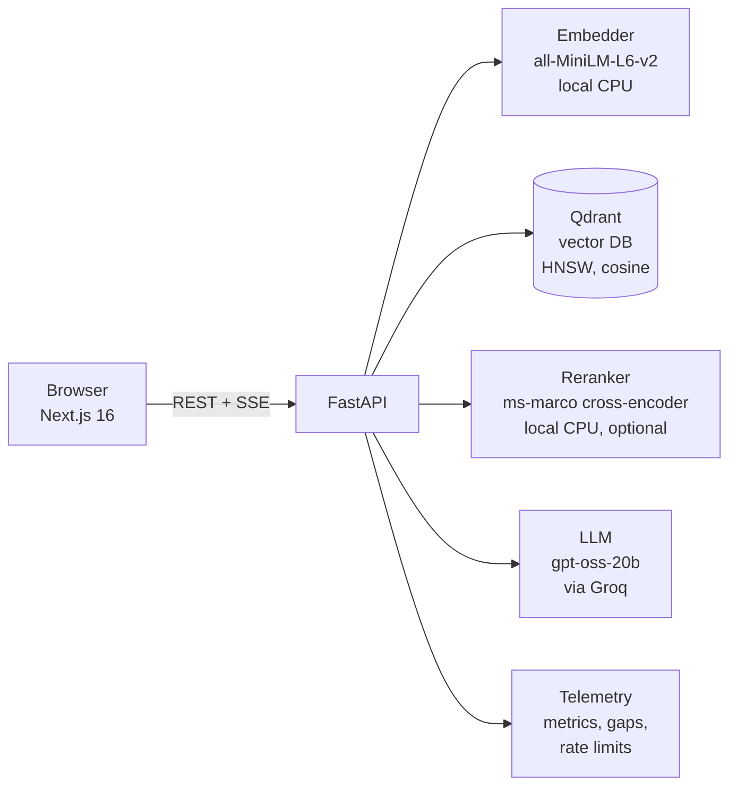
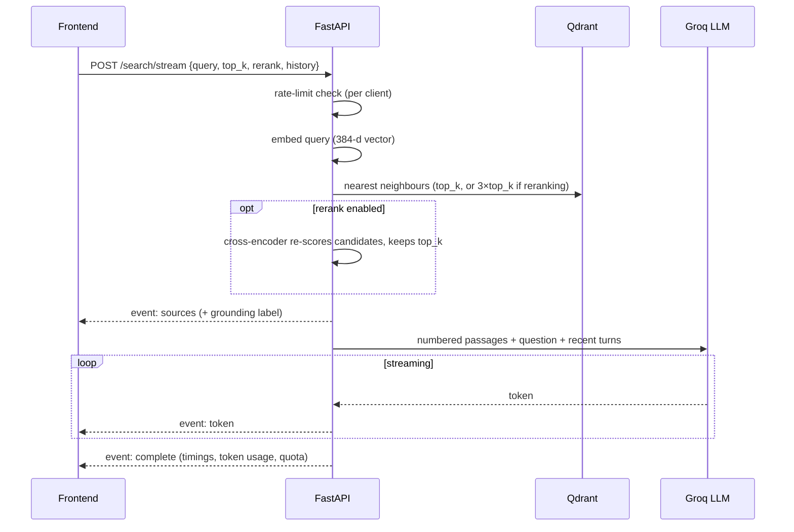

# Wally

**A company knowledge assistant built on retrieval-augmented generation (RAG).**
Upload internal documents, ask questions in plain language, and get answers that cite the exact passages they came from, with every step of the pipeline measured live.

  

---

## Contents

1. [What it does](#what-it-does)
2. [Architecture](#architecture)
3. [How a question is answered](#how-a-question-is-answered)
4. [Features](#features)
5. [Tech stack](#tech-stack)
6. [Getting started](#getting-started)
7. [Configuration](#configuration)
8. [API reference](#api-reference)
9. [Project structure](#project-structure)
10. [Metrics explained](#metrics-explained)
11. [Design decisions](#design-decisions)
12. [Limitations and future work](#limitations-and-future-work)

---

## What it does

| Problem in a company | How Wally addresses it |
|---|---|
| Knowledge is scattered across PDFs, policies and wikis | One searchable library of PDF, TXT and Markdown files |
| Chatbots invent answers | Answers are generated **only** from retrieved passages and cite them as `[1]`, `[2]` |
| Nobody knows if an answer can be trusted | Each answer carries a **grounding label** derived from retrieval scores |
| Documentation gaps go unnoticed | Weakly matched or down-voted questions are logged as **knowledge gaps** |
| AI systems are a black box | **Latency per stage and real token usage** are shown for every answer |

**Demo:** [`docs/DEMO_GUIDE.md`](docs/DEMO_GUIDE.md) runs Wally as Apple's internal assistant on its real FY2025 10-K, with tested questions, a hand-checked evaluation (6 of 7 correct) and the one systematic failure explained.

---

## Architecture



Three processes run locally: **Qdrant** (Docker, port 6333), the **FastAPI** backend (port 8001) and the **Next.js** frontend (port 3000). Embedding and reranking run on the local CPU; only answer generation calls an external API.

---

## How a question is answered



**Ingestion** works the other way round: a file is parsed (pypdf for PDF), split into ~512-character chunks with a 50-character overlap at sentence boundaries, embedded, and stored in Qdrant with its file name, chunk index and upload time. Uploading a file with an existing name replaces its old chunks.

---

## Features

### Answering
- **Token streaming** over Server-Sent Events, with live stage progress and a Stop button.
- **Inline citations.** Clicking a number opens the source passage; the file name opens the full document preview.
- **Grounding label** per answer: well, partly or weakly grounded, or no sources found.
- **Follow-up questions** use the last three exchanges as conversation context.
- **Optional reranking** with a cross-encoder that re-scores three times as many candidates and keeps the best.

### Observability
- **Per answer:** total time, time to first token, prompt and completion tokens (reported by the provider), and an embed / search / rerank / generate breakdown.
- **Performance view:** median and 95th-percentile latency, average tokens, and a stacked chart of recent questions, with a table alternative.

### Library
- Drag-and-drop upload of several files at once, with **automatic retries** (exponential back-off: 1 s, 2 s, 4 s) for network errors, 5xx and 429 responses.
- **Document preview:** every passage, length statistics, a length histogram, and a citation map showing which parts of a document actually get used. Passages cited in recent answers are highlighted.

### Reliability
- **Per-client rate limiting** (sliding 60-second window) with `X-RateLimit-*` and `Retry-After` headers.
- The sidebar shows **remaining queries** and the **model provider's own token quota**; questions over the limit are **queued** and sent automatically when the window resets.
- **Connection indicator**: health check every 10 s (every 3 s while offline), with notifications when the API or database goes down or recovers.
- **Toast notifications** for uploads, deletions, feedback and errors.

### Knowledge gaps
- Questions whose best match is below a similarity threshold, and answers marked *Not helpful*, are stored in `wally_data/insights.json`.
- The gaps view lists them by frequency so the team knows which document to write next.

### Wally, the mascot
- A pixel-art storm-cloud (Stormhead sprites) peeks from the bottom-right corner, or sideways from the right edge on phones.
- **Click** him for a random reaction and a typed pixel speech bubble; click four times quickly and he faints and respawns.
- On every **page change** he makes a cameo with a page-specific line, then sprints or beams back to his corner.
- Now and then (or with **Shift + W**) he goes on a **rampage**, charging across the screen firing lightning at "hallucinations".
- Sprites are stepped with GPU transforms from a single 38 KB atlas. He respects reduced-motion settings and never interrupts typing.

---

## Tech stack

| Layer | Choice | Why |
|---|---|---|
| Frontend | Next.js 16, React 19, Tailwind CSS 4 | Streaming UI, component model, fast iteration |
| Typography | Satoshi (display), Figtree (text), Pixelify Sans (mascot) | Distinct headings, readable body text, pixel speech bubbles |
| Backend | FastAPI + Uvicorn | Async, typed request models, native streaming responses |
| Embeddings | `sentence-transformers/all-MiniLM-L6-v2` (384-d) | Free, local, ~50 ms per query on CPU |
| Vector DB | Qdrant (HNSW, cosine) | Fast approximate search, payload filters, runs in Docker |
| Reranker | `cross-encoder/ms-marco-MiniLM-L-6-v2` | Reads query and passage together, so it is more precise than vector similarity |
| LLM | `openai/gpt-oss-20b` via Groq | Free tier, very high tokens per second |
| PDF parsing | pypdf | Lightweight, no native dependencies |
| Events (optional) | Inngest | Background ingestion and search functions |

---

## Getting started

### Prerequisites
- Python 3.11 or 3.12
- Node.js 20+
- Docker Desktop
- A free Groq API key from <https://console.groq.com>

### 1. Clone and start the vector database
```bash
git clone https://github.com/ichor-hash/Wally.git
cd Wally

docker run -d --name wally-qdrant -p 6333:6333 -p 6334:6334 \
  -v wally_qdrant:/qdrant/storage qdrant/qdrant
```
The named volume keeps the index across container restarts.

### 2. Backend
```bash
python -m venv venv
venv\Scripts\activate            # macOS/Linux: source venv/bin/activate
pip install -r requirements.txt
copy .env.example .env           # macOS/Linux: cp .env.example .env, then add GROQ_API_KEY
python -m uvicorn main:app --port 8001 --reload
```
The embedding model downloads on first start (~90 MB). The reranker downloads the first time it is switched on.

### 3. Frontend
```bash
cd wally-frontend
npm install
npm run dev
```
Open <http://localhost:3000>. API docs: <http://localhost:8001/docs>. Qdrant dashboard: <http://localhost:6333/dashboard>.

---

## Configuration

All settings are environment variables, read from `.env` (see `.env.example`).

| Variable | Default | Purpose |
|---|---|---|
| `GROQ_API_KEY` | (required) | LLM access |
| `COMPANY_NAME` | `your company` | Who the assistant works for (system prompt and Ask screen) |
| `COMPANY_PROFILE` | (empty) | Short company background added to the system prompt; not a citable source |
| `ASSISTANT_NAME` | `Wally` | Assistant name in the system prompt |
| `RATE_LIMIT` | `30` | Questions per minute per client |
| `GAP_THRESHOLD` | `0.25` | Best-match similarity below this is logged as a knowledge gap |
| `CHUNK_SIZE` / `CHUNK_OVERLAP` | `512` / `50` | Chunking, in characters |
| `RERANK_MODEL` | `cross-encoder/ms-marco-MiniLM-L-6-v2` | Cross-encoder used for reranking |
| `QDRANT_URL` / `QDRANT_COLLECTION` | `http://localhost:6333` / `docs` | Vector store |
| `NEXT_PUBLIC_API_BASE` (frontend) | `http://localhost:8001` | Backend URL |

In-app settings (stored in the browser): streaming on/off, reranking on/off, sources per answer (1–15).

---

## API reference

| Method | Path | Description |
|---|---|---|
| `POST` | `/search` | Answer a question; returns answer, sources, grounding label, metrics |
| `POST` | `/search/stream` | Same, as Server-Sent Events: `stage`, `sources`, `token`, `complete`, `error` |
| `POST` | `/ingest/pdf` | Upload a PDF, TXT or MD file (multipart `file`) |
| `POST` | `/ingest/texts` | Ingest raw strings |
| `POST` | `/ingest/directory` | Ingest every supported file in a server-side folder |
| `GET` | `/documents` | Documents with passage counts, size and citation totals |
| `GET` | `/documents/{name}/chunks` | Passages, length statistics, histogram and usage counts |
| `DELETE` | `/documents/{name}` | Remove a document and all of its passages |
| `GET` | `/health` | Service, database and model status |
| `GET` | `/metrics` | Latency percentiles, averages and the last 30 queries |
| `GET` | `/rate-limit` | Caller's quota and the provider's latest quota headers |
| `GET` | `/insights` | Knowledge gaps and feedback totals |
| `DELETE` | `/insights/gaps?normalized=…` | Mark a gap resolved |
| `POST` | `/feedback` | Rate an answer `up` or `down` |
| `POST` | `/reranker/warmup` | Load the cross-encoder ahead of first use |

Request body for `/search` and `/search/stream`:
```json
{ "query": "How many days can I work remotely?", "top_k": 5, "rerank": true,
  "history": [{ "role": "user", "content": "..." }, { "role": "assistant", "content": "..." }] }
```

---

## Project structure

```
Wally-master/
├── main.py              FastAPI app: retrieval pipeline, streaming, endpoints, Inngest functions
├── vector_db.py         Qdrant wrapper: embed, search, paginated scroll, delete by document
├── embeddings.py        Embedding providers (HuggingFace local by default)
├── reranker.py          Lazy-loaded cross-encoder reranker
├── llm.py               LLM providers: completion, streaming, token usage, quota headers
├── telemetry.py         Query metrics, knowledge gaps, feedback, per-client rate limiter
├── data_loader.py       PDF/TXT/MD loading and sentence-aware chunking with overlap
├── queries.py           Python interface for scripted use without the API
├── app.py               Legacy Streamlit UI (optional)
├── requirements.txt
├── .env.example
├── demo/                Apple FY2025 10-K: Risk Factors and MD&A, ready to upload
├── docs/
│   ├── DEMO_GUIDE.md          Ten-minute demo script, tested questions, evaluation, Q&A
│   └── TECHNICAL_OVERVIEW.md  Background essay on the original design
└── wally-frontend/      Next.js app
    ├── app/             layout, global styles, page (state and data flow), fonts
    ├── components/      Sidebar, Exchange (Q&A), Markdown, DocumentDrawer, Toaster, ui
    │   ├── mascot/      Wally sprite engine and his lines
    │   └── views/       Ask, Library, Performance, Knowledge gaps, Settings
    ├── public/wally/    Mascot sprite atlas
    └── lib/api.ts       Typed API client, SSE parser, upload with progress
```

---

## Metrics explained

| Metric | Meaning | Typical value (laptop CPU) |
|---|---|---|
| Embed | Turning the question into a 384-d vector | ~50 ms |
| Search | Qdrant nearest-neighbour lookup | ~20–40 ms |
| Rerank | Cross-encoder scoring of 3×top_k passages | ~0.15 s warm |
| Generate | LLM round trip, first byte to last token | ~1 s |
| First token | Time from request until the first answer token appears | ~1.1 s |
| Prompt / completion tokens | Exact counts reported by Groq | ~900 / ~450 |
| Match | Cosine similarity between question and passage (0–100%) | 25–75% for relevant text |
| Relevance | Cross-encoder probability that the passage answers the question | close to 0% or 100% |

**Grounding label.** Without reranking, the top match decides: 50% or above is *well grounded*, 25% or above is *partly grounded*, anything lower is *weakly grounded*. With reranking, the thresholds are 70% and 30% on the relevance score.

---

## Design decisions

- **Citations over trust.** The prompt numbers each passage and requires `[n]` citations, so every claim can be checked in one click.
- **Measure, don't estimate.** Token counts come from the provider's usage field rather than a characters ÷ 4 estimate, and each pipeline stage is timed separately.
- **Retrieve wide, then rerank narrow.** Vector search is fast but approximate; the cross-encoder is precise but slow. Fetching 3×top_k candidates and reranking them gets the benefits of both.
- **Re-upload replaces.** Documents are keyed by file name, so updating a policy never leaves stale passages behind.
- **Degrade gracefully.** Rate-limited questions queue instead of failing; uploads retry; the UI keeps working, and says so, when the API is down.
- **Quiet interface.** A neutral palette and typographic hierarchy keep attention on the answers and their sources.

---

## Limitations and future work

| Limitation | Possible next step |
|---|---|
| Query metrics and rate-limit windows are in memory and reset on restart | Store them in Redis or Postgres |
| No user accounts or document-level permissions | SSO and per-team collections |
| Scanned PDFs (images) contain no extractable text | Add OCR (Tesseract) |
| Character-based chunking | Semantic or heading-aware chunking |
| Grounding is score-based, not a fact check | Add an LLM-as-judge faithfulness check |
| English-only embedding model | Multilingual embeddings (e.g. `bge-m3`) |

See [CHANGELOG.md](CHANGELOG.md) for the release history.
