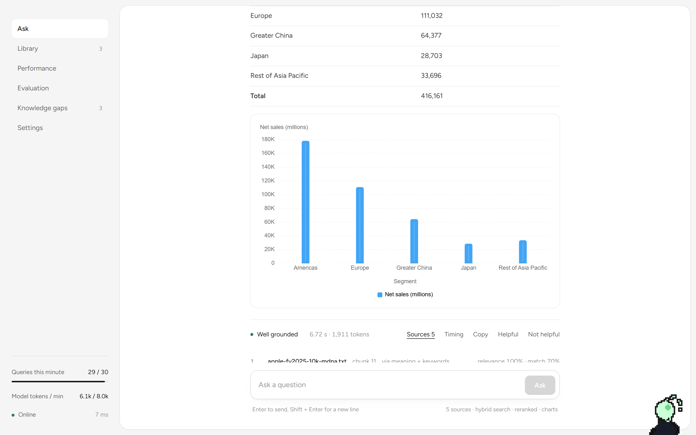
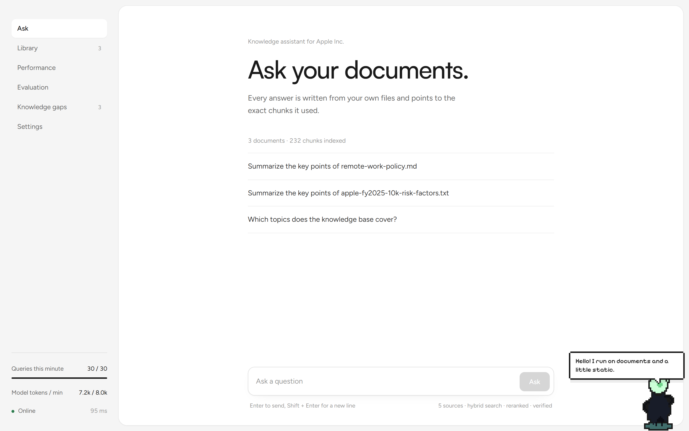
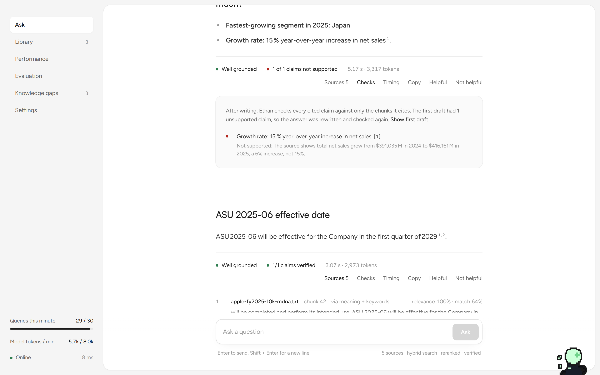
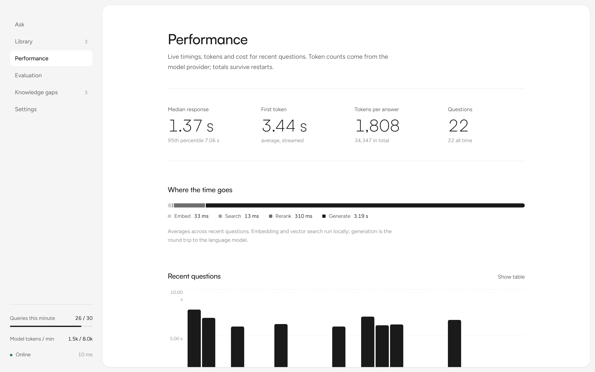
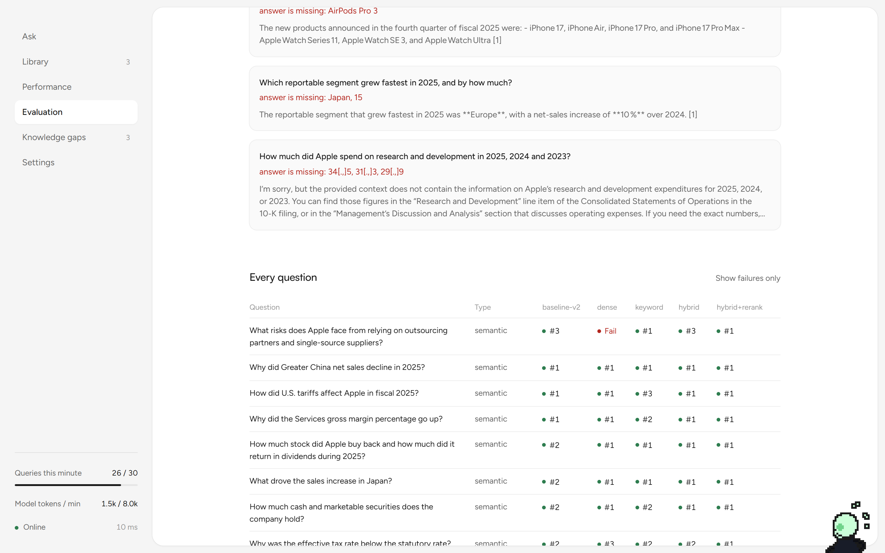
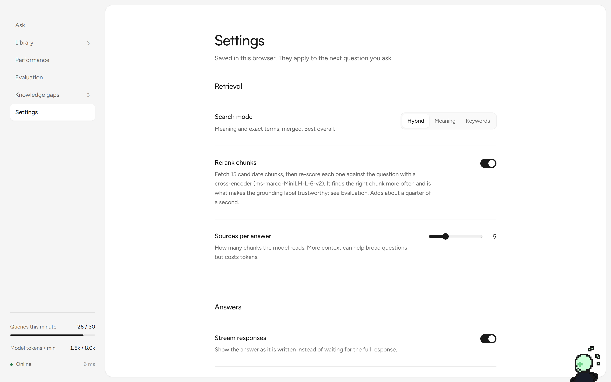
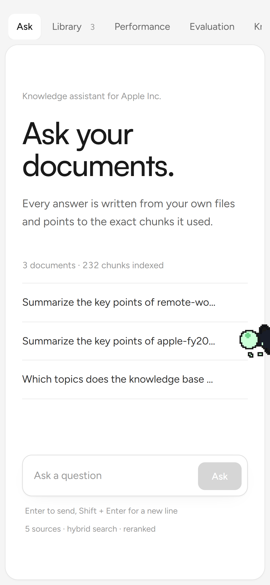
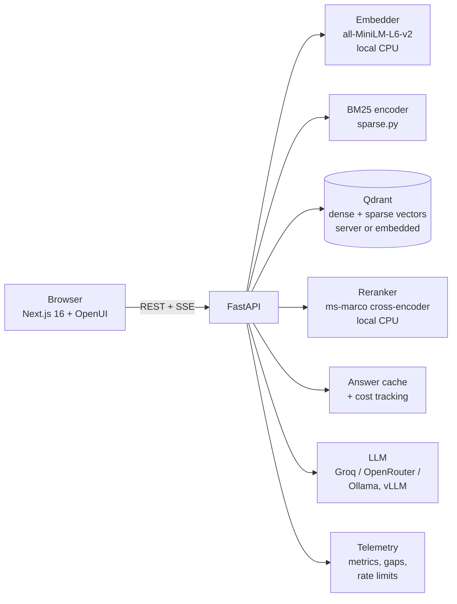
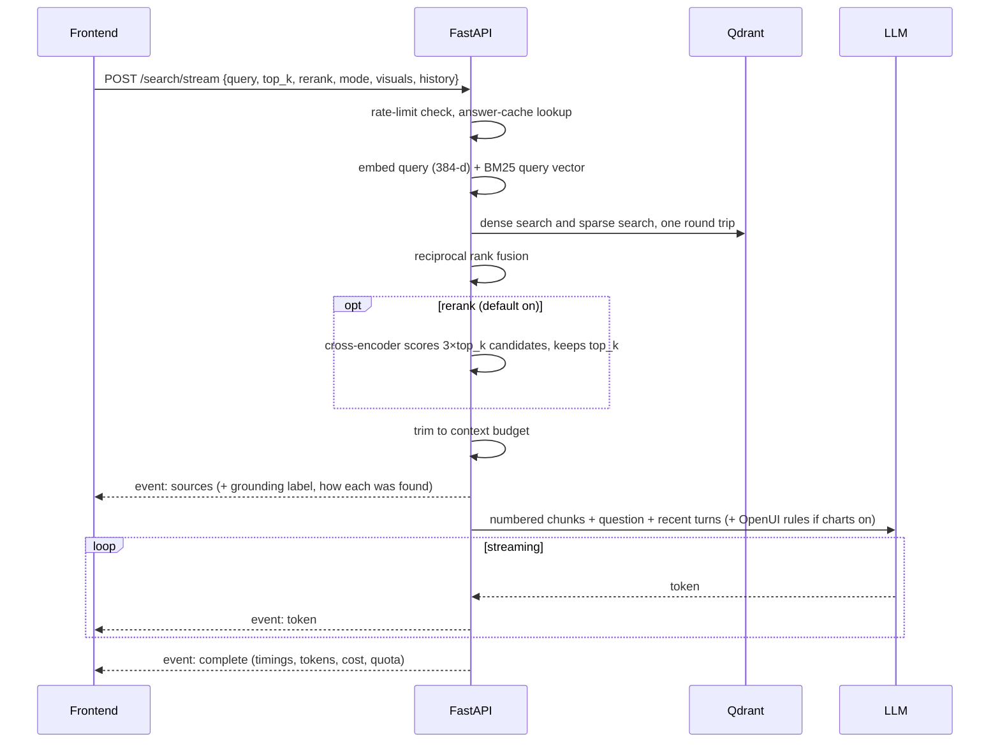

# Ethan

**A company knowledge assistant built on retrieval-augmented generation (RAG).**
Upload internal documents, ask questions in plain language, and get answers that cite the exact chunks they came from. Retrieval is hybrid (meaning + keywords) and reranked, every answer is measured for latency, tokens and cost, and every change is checked against an evaluation set in CI.

[](https://github.com/ichor-hash/Wally/actions/workflows/ci.yml)     



---

## Contents

1. [What it does](#what-it-does)
2. [Screenshots](#screenshots)
3. [Evaluation results](#evaluation-results)
4. [Architecture](#architecture)
5. [How a question is answered](#how-a-question-is-answered)
6. [Features](#features)
7. [Getting started](#getting-started)
8. [Configuration](#configuration)
9. [API reference](#api-reference)
10. [Project structure](#project-structure)
11. [Design decisions](#design-decisions)
12. [Limitations and next steps](#limitations-and-next-steps)

Guides: [Hosting](docs/HOSTING.md) · [Costs](docs/COSTS.md) · [Evaluation](docs/EVALUATION.md) · [Runbook](docs/RUNBOOK.md) · [Demo script](docs/DEMO_GUIDE.md)

---

## What it does

| Problem in a company | How Ethan addresses it |
|---|---|
| Knowledge is scattered across PDFs, policies and wikis | One searchable library of PDF, TXT and Markdown files |
| Chatbots invent answers | Answers come **only** from retrieved chunks and cite them as `[1]`, `[2]` |
| Search misses exact terms like `ASU 2025-06` or a product code | **Hybrid retrieval**: vector similarity and BM25 keyword search, fused by rank |
| Nobody knows if an answer can be trusted | A **grounding label** from a cross-encoder that reads question and chunk together |
| Tables get split and answered wrongly | **Structure-aware chunking** keeps each table whole with its caption |
| Numbers are hard to compare in prose | Optional **charts and tables** drawn with [OpenUI](https://www.openui.com) |
| AI costs creep up | Per-answer **cost**, an **answer cache**, context and output budgets, local-model support |
| "It seems to work" | A **36-question evaluation** in CI that fails the build on regressions |
| Documentation gaps go unnoticed | Weakly grounded or down-voted questions are logged as **knowledge gaps** |

---

## Screenshots

| | |
|---|---|
|  **Ask.** The empty state, with suggestions from the library. |  **Hybrid sources.** Each source says how it was found and how relevant the reranker judged it. |
|  **Honest refusal.** Not in the documents: weakly grounded, declined, and logged as a gap. |  **Library.** Upload, preview chunks, see which parts get cited. |
|  **Performance.** Median and p95 latency, time per stage. |  **Tokens and cost.** Per question, lifetime, and what the cache saved. |
|  **Evaluation.** Five retrieval setups compared on 36 questions. |  **Every case.** Passes and failures, with the reason on hover. |
|  **Settings.** Search mode, reranking, charts, and the live system configuration. |  **Phone layout.** |

---

## Evaluation results

Measured on 36 questions with known answers over Apple's FY2025 10-K (Risk Factors and MD&A) and a sample HR policy. Details, every failure and how to add cases: [docs/EVALUATION.md](docs/EVALUATION.md). Full report: [evals/results/REPORT.md](evals/results/REPORT.md).

| Retrieval setup | Passed | Right chunk first | In top 5 | Unanswerable caught | Latency |
|---|---|---|---|---|---|
| v2: fixed chunks, vector only | 29/36 | 53% | 88% | 25% | 10 ms |
| Hybrid (vector + BM25) | 31/36 | 75% | 94% | 25% | 13 ms |
| **Hybrid + reranker (default)** | **35/36** | **91%** | **97%** | **100%** | 251 ms |

| Generated answers (`gpt-oss-20b`) | Correct | Tokens per answer |
|---|---|---|
| v2 setup | 24/27 | 954 in, 84 out |
| **v3 default** | **27/27** | **826 in, 78 out** |

The v2 headline failure: asked which segment grew fastest, it answered "Europe, +10%" with a *well grounded* label. The answer was wrong; the correct one is Japan, +15%. The segment table had been split across two chunks. v3 keeps tables whole and gets it right.

CI runs the retrieval evaluation on every push and fails below set thresholds. The answer evaluation runs on demand from the Actions tab.

---

## Architecture



Embedding, keyword encoding, search and reranking run on the local CPU. Only the question and the selected chunks go to the language model, and with a local model (Ollama, vLLM) nothing leaves the machine. Qdrant runs either as a server (Docker, Qdrant Cloud) or embedded in the API process with no server at all.

---

## How a question is answered



**Ingestion** works the other way round:

1. The file is parsed (pypdf for PDF).
2. It is split into structure-aware chunks: paragraphs packed up to about 512 characters, headings kept with their text, each table kept whole with its caption.
3. Each chunk is embedded and BM25-encoded, then stored with its file name, section, kind (text or table) and upload time.

Uploading a file with an existing name replaces its old chunks.

---

## Features

### Retrieval
- **Hybrid search.** Dense vectors find paraphrases; BM25 finds exact identifiers, codes and names. Qdrant applies the IDF weighting server-side, so nothing needs refitting as documents change. Both rankings are fused with reciprocal rank fusion. A *Meaning* or *Keywords* mode is one click away in Settings.
- **Cross-encoder reranking**, on by default. It re-scores three times as many candidates and keeps the best. Its relevance score drives the grounding label, which is why unanswerable questions are reliably flagged.
- **Structure-aware chunking.** Tables stay whole with their caption, headings travel with their text, and fragments are merged. The old fixed window is still available as `CHUNK_STRATEGY=fixed`.
- **Every source explains itself**: found via meaning, keywords or both, with match and relevance scores.

### Answering
- **Token streaming** over Server-Sent Events, with live stage progress and a Stop button.
- **Inline citations.** Clicking a number opens the source chunk; the file name opens the document preview.
- **Charts and tables with OpenUI.** When an answer compares several numbers, the model can add a bar, line, area or pie chart, or a table, written in OpenUI Lang and rendered by `@openuidev/react-lang`. The component set is display-only (no forms or actions), malformed output falls back to showing the source, and the instructions sent to the model are generated from the same component library the browser renders with.
- **Follow-up questions** use the last three exchanges as context.

### Cost
- Per-answer **tokens and dollars**, plus lifetime totals that survive restarts.
- **Answer cache**, invalidated automatically by any library change.
- **Context and output budgets**, low reasoning effort for `gpt-oss` models, and support for **free local models**. See [docs/COSTS.md](docs/COSTS.md).

### Observability
- **Per answer:** total time, time to first token, prompt and completion tokens, cost, search mode, and an embed / search / rerank / generate breakdown.
- **Performance view:** median and 95th-percentile latency, a stacked chart of recent questions, token and latency trends, and cost (charts rendered with OpenUI).
- **Evaluation view:** the latest evaluation report, per configuration, per question type, and per question.

### Library
- Drag-and-drop upload of several files at once, with **automatic retries** (1 s, 2 s, 4 s back-off) for network errors, 5xx and 429 responses.
- **Document preview:** every chunk, length statistics, a histogram, and a citation map showing which parts of a document actually get used.

### Reliability
- **Per-client rate limiting** with `X-RateLimit-*` and `Retry-After` headers. Questions over the limit are **queued** and sent automatically.
- The sidebar shows remaining queries and the **model provider's own token quota**.
- **Connection indicator** with notifications when the API or database goes down or recovers. The API starts even without an LLM key and says what is missing.

### Knowledge gaps
- Weakly grounded questions and answers marked *Not helpful* are stored in `ethan_data/insights.json` and listed by frequency, so the team knows which document to write next.

### Ethan, the mascot
- A pixel-art storm cloud in the corner. Click him for a reaction, click four times and he faints, press **Shift + E** and he charges across the screen zapping "hallucinations". He respects reduced-motion settings and never interrupts typing.

---

## Getting started

### Prerequisites
- Python 3.11 or 3.12
- Node.js 20+
- A free Groq API key from <https://console.groq.com>, **or** a local model server such as [Ollama](https://ollama.com)
- Docker is **optional**. Qdrant runs embedded by default.

### 1. Backend
```bash
git clone https://github.com/ichor-hash/Wally.git ethan
cd ethan

python -m venv venv
venv\Scripts\activate            # macOS/Linux: source venv/bin/activate
pip install torch==2.14.1 --index-url https://download.pytorch.org/whl/cpu   # CPU build, ~10x smaller
pip install -r requirements.txt
copy .env.example .env           # macOS/Linux: cp .env.example .env, then add GROQ_API_KEY
python -m uvicorn main:app --port 8001 --reload
```
The embedding model and reranker download on first start (about 175 MB in total).

### 2. Frontend
```bash
cd ethan-frontend
npm install
npm run dev
```
Open <http://localhost:3000>. API docs: <http://localhost:8001/docs>.

### 3. Try it
Drag the two files in `demo/` into the **Library**, then ask *"Which reportable segment grew fastest in 2025?"*, or turn on **Charts and tables** in Settings and ask *"Chart net sales by reportable segment for 2025."*

### 4. Check it
```bash
pip install -r requirements-dev.txt
pytest -q tests                   # unit tests, no downloads or API key
python evals/run_evals.py         # retrieval evaluation, writes evals/results/
python evals/run_evals.py --answers   # also grade generated answers (uses your LLM key)
```

Running it all with Docker, deploying to a server or managed services, and running fully private with a local model: [docs/HOSTING.md](docs/HOSTING.md). Day-to-day commands and troubleshooting: [docs/RUNBOOK.md](docs/RUNBOOK.md).

---

## Configuration

All settings are environment variables read from `.env`; [`.env.example`](.env.example) lists every one with its default.

| Variable | Default | Purpose |
|---|---|---|
| `LLM_PROVIDER` | `groq` | `groq`, `openrouter` or `openai_compatible` (Ollama, LM Studio, vLLM, llama.cpp) |
| `GROQ_API_KEY` / `OPENROUTER_API_KEY` | | Cloud LLM access |
| `LLM_MODEL` | provider default (`openai/gpt-oss-20b` on Groq) | Model name |
| `LLM_BASE_URL` / `LLM_API_KEY` | `http://localhost:11434/v1` | For `openai_compatible` |
| `COMPANY_NAME` / `COMPANY_PROFILE` | | Who the assistant works for; background that is not a citable source |
| `QDRANT_PATH` | | Run Qdrant embedded in this folder; no server needed |
| `QDRANT_URL` / `QDRANT_API_KEY` | `http://localhost:6333` | Qdrant server or Qdrant Cloud, when `QDRANT_PATH` is empty |
| `QDRANT_COLLECTION` | `ethan_docs` | Collection name |
| `RETRIEVAL_MODE` | `hybrid` | Default search mode: `hybrid`, `dense` or `keyword` |
| `CHUNK_STRATEGY` | `structure` | `structure` or `fixed` |
| `CHUNK_SIZE` / `CHUNK_OVERLAP` | `512` / `50` | Characters |
| `EMBED_MODEL` / `RERANK_MODEL` | MiniLM-L6 bi-encoder / ms-marco cross-encoder | Local models |
| `GAP_THRESHOLD` | `0.25` | Best match below this is logged as a knowledge gap |
| `LLM_PRICE_INPUT_PER_M` / `LLM_PRICE_OUTPUT_PER_M` | `0` | USD per million tokens, for cost tracking |
| `LLM_REASONING_EFFORT` | `low` | Reasoning effort for `gpt-oss` models |
| `MAX_CONTEXT_CHARS` / `MAX_OUTPUT_TOKENS` | `8000` / `1024` | Prompt and completion budgets |
| `ANSWER_CACHE_TTL` / `ANSWER_CACHE_SIZE` | `3600` / `256` | Answer cache; TTL `0` disables it |
| `RATE_LIMIT` | `30` | Questions per minute per client |
| `CORS_ORIGINS` | `http://localhost:3000,...` | Origins allowed to call the API |
| `ALLOW_DIRECTORY_INGEST` | `false` | Enables `/ingest/directory`; trusted networks only |
| `INNGEST_ENABLED` | `false` | Event-driven ingestion and search (needs `requirements-optional.txt`) |
| `NEXT_PUBLIC_API_BASE` (frontend) | `http://localhost:8001` | Backend URL |

In-app settings, stored in the browser: search mode, reranking, sources per answer, streaming, charts and tables.

---

## API reference

| Method | Path | Description |
|---|---|---|
| `POST` | `/search` | Answer a question; returns answer, sources, grounding label, metrics |
| `POST` | `/search/stream` | Same, as Server-Sent Events: `stage`, `sources`, `token`, `complete`, `error` |
| `POST` | `/ingest/pdf` | Upload a PDF, TXT or MD file (multipart `file`) |
| `POST` | `/ingest/texts` | Ingest raw strings |
| `POST` | `/ingest/directory` | Ingest a server-side folder (off unless `ALLOW_DIRECTORY_INGEST=true`) |
| `GET` | `/documents` | Documents with chunk and table counts, size and citation totals |
| `GET` | `/documents/{name}/chunks` | Chunks with section and kind, length statistics, usage counts |
| `DELETE` | `/documents/{name}` | Remove a document and all of its chunks |
| `GET` | `/health` | Service, database, model, retrieval and cost configuration |
| `GET` | `/metrics` | Latency percentiles, tokens, cost, cache stats, last 30 queries |
| `GET` | `/evals` | Latest evaluation report |
| `GET` | `/rate-limit` | Caller's quota and the provider's latest quota headers |
| `GET` | `/insights` | Knowledge gaps and feedback totals |
| `DELETE` | `/insights/gaps?normalized=…` | Mark a gap resolved |
| `POST` | `/feedback` | Rate an answer `up` or `down` |
| `POST` | `/reranker/warmup` | Load the cross-encoder ahead of first use |

Request body for `/search` and `/search/stream`:
```json
{ "query": "How many days can I work remotely?", "top_k": 5, "rerank": true, "mode": "hybrid", "visuals": false,
  "history": [{ "role": "user", "content": "..." }, { "role": "assistant", "content": "..." }] }
```

---

## Project structure

```
├── main.py              FastAPI app: endpoints, streaming, prompt, cache and cost wiring
├── pipeline.py          Retrieval pipeline shared by the API and the evaluation
├── vector_db.py         Qdrant: dense + BM25 vectors, hybrid search with RRF, server or embedded
├── sparse.py            BM25 encoder for the keyword half of hybrid search
├── reranker.py          Lazy-loaded cross-encoder reranker
├── data_loader.py       PDF/TXT/MD loading; structure-aware and fixed chunking
├── embeddings.py        Embedding providers (local sentence-transformers by default)
├── llm.py               LLM providers: Groq, OpenRouter, any OpenAI-compatible server
├── costs.py             Token pricing and the answer cache
├── telemetry.py         Metrics, cost totals, knowledge gaps, feedback, rate limiting
├── prompts/openui.txt   Chart instructions, generated from the frontend's OpenUI library
├── evals/               Golden questions, the harness, and committed results
├── tests/               Unit tests (no downloads, no API key)
├── scripts/             migrate_collection.py: upgrade a v2 collection in place
├── demo/                Apple FY2025 10-K: Risk Factors and MD&A
├── docs/                Hosting, costs, evaluation, runbook, demo script, screenshots
├── Dockerfile, docker-compose.yml
├── .github/workflows/   CI (tests, eval gate, frontend) and on-demand answer evaluation
└── ethan-frontend/      Next.js app
    ├── components/      Sidebar, Exchange, Markdown, Visual (OpenUI), DocumentDrawer, views/
    ├── lib/             api.ts (typed client), openui.ts (chart builders), visuals-library.ts
    └── scripts/         gen-openui-prompt.mjs
```

---

## Design decisions

- **Measure before and after.** Every retrieval change was kept or dropped on the evaluation's numbers. Hybrid search alone did not catch unanswerable questions; the reranker did, so the reranker is on by default.
- **Two kinds of search, one ranking.** Rank fusion needs no score calibration between cosine and BM25, which live on different scales.
- **Let the database do IDF.** BM25 document weights are computed locally from term frequencies; Qdrant applies inverse document frequency at query time. The encoder needs no corpus statistics, no model and no refit when documents change.
- **Citations over trust.** The prompt numbers each chunk and requires `[n]` citations, so every claim can be checked in one click.
- **Charts are optional and contained.** The model may only use display components, the written answer must stand on its own, and a malformed chart degrades to showing its source, never to a broken answer.
- **Cheap by default.** Local embeddings and reranking, an answer cache that invalidates itself, budgets on context and output, and a one-line switch to a free local model.
- **Re-upload replaces.** Documents are keyed by file name, so updating a policy never leaves stale chunks behind.
- **Degrade gracefully.** Rate-limited questions queue, uploads retry, the API runs without an LLM key, and an old collection works dense-only until migrated.

---

## Limitations and next steps

| Limitation | Possible next step |
|---|---|
| No user accounts or document-level permissions | SSO in front of the API and per-team collections (see [HOSTING.md](docs/HOSTING.md#before-you-expose-it-to-a-network)) |
| Telemetry and cache are per process | Move `telemetry.py` storage to Postgres or Redis for multi-replica deployments |
| One paraphrase still fails retrieval (`s12`) | A stronger embedding model, checked with the evaluation |
| Grounding is a relevance score, not a fact check | An answer-verification step that checks each claim against its cited chunk |
| Scanned PDFs have no extractable text | OCR on ingestion |
| English-only embedding model | Multilingual embeddings such as `bge-m3` |
| OpenUI charts use OpenUI's own colour ramp | Wrap the chart components in a custom library to theme them |

See [CHANGELOG.md](CHANGELOG.md) for the release history.
