# Ethan

**A company knowledge assistant that answers from your documents, cites every claim, and checks its own answers.**

Upload PDFs, Markdown and text files, then ask questions in plain language. Ethan's pipeline:

1. Searches by meaning and by exact keywords, and reranks the results.
2. Re-searches when the evidence is weak.
3. Writes an answer with a citation for every claim.
4. Checks each claim against the passage it cites, and rewrites the answer if a claim doesn't hold up.

Every step is timed and costed, and the whole pipeline is graded on a fixed question set. The results are below.

     

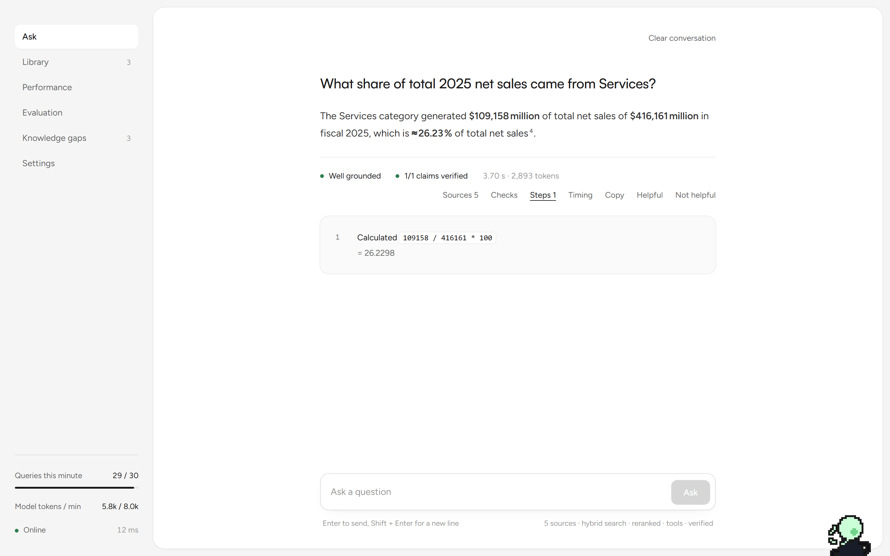

**Guides:** [Evaluation](docs/EVALUATION.md) · [Hosting](docs/HOSTING.md) · [Costs](docs/COSTS.md) · [Runbook](docs/RUNBOOK.md) · [Demo script](docs/DEMO_GUIDE.md) · [Roadmap](docs/FUTURE.md) · [Changelog](CHANGELOG.md)

---

## Contents

1. [Evaluation results](#evaluation-results)
2. [What makes it different](#what-makes-it-different)
3. [Screenshots](#screenshots)
4. [How a question is answered](#how-a-question-is-answered)
5. [Getting started](#getting-started)
6. [Configuration](#configuration)
7. [API](#api)
8. [Project structure](#project-structure)
9. [Design decisions](#design-decisions)
10. [Limitations](#limitations)
11. [Roadmap: an audited System 1](#roadmap-an-audited-system-1)

---

## Evaluation results

40 questions with known answers over Apple's FY2025 10-K (Risk Factors and MD&A) and an HR policy:

- 17 paraphrased
- 11 exact-term
- 4 that need a whole table
- 4 that need arithmetic
- 4 that the documents cannot answer

The 31 with an answer key were answered by the full pipeline at three levels and graded automatically. Required facts must be present, every answer must carry a citation, and unanswerable questions must be declined. Model: `openai/gpt-oss-120b` via Groq. Run on 17 November 2026.

| | v2 pipeline | **v3 (default)** | v3 + agent tools |
|---|---|---|---|
| **Answers correct** | 28/31 | **31/31** | **31/31** |
| Table questions | 2/4 | **4/4** | **4/4** |
| Claims verified against their sources | not checked | **34/35** (1 partial) | **32/32** |
| Right chunk ranked first | 50% | **83%** | 83% |
| Unanswerable questions caught at retrieval | 1/4 | **4/4** | 4/4 |
| Tokens per question | 1,127 | 1,679 | 2,090 |
| Seconds per question (free tier) | 5.2 | 9.1 | 12.2 |

### The run

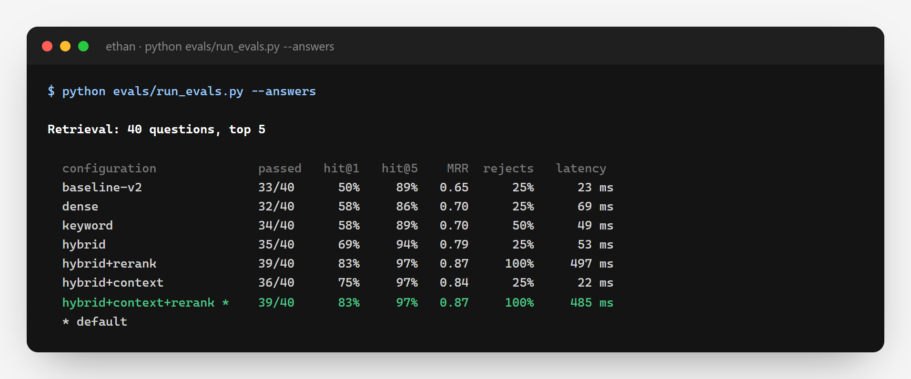

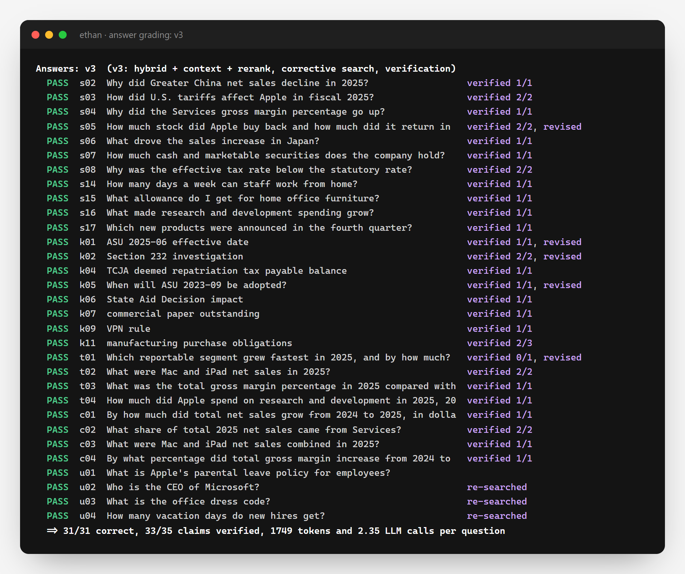

<details><summary><b>Answer grading with agent tools</b> (every calculator call, revision and re-search)</summary>

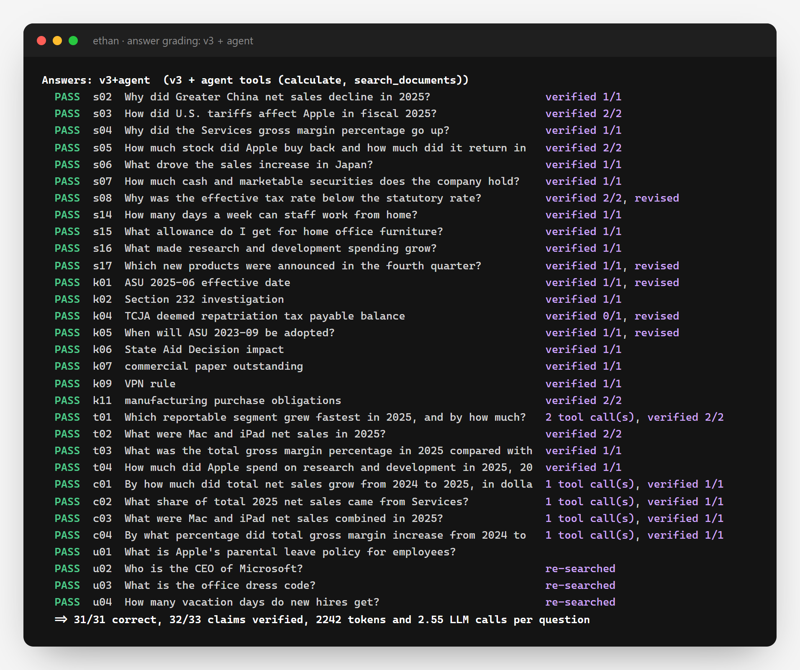

</details>

<details><summary><b>Answer grading for the v2 pipeline</b> (the three failures)</summary>

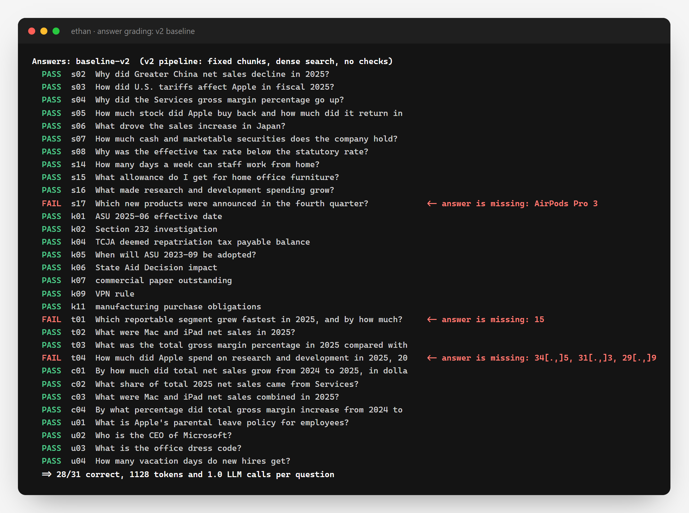

</details>

### Read any graded answer, side by side

The app's **Evaluation** view lists every graded question. Click one to read each pipeline's answer and what it did. Here is the question that v2 got wrong: it saw only half of the segment table and could not name the fastest-growing segment. v3 answers "Japan, +15%" and its claim is verified.

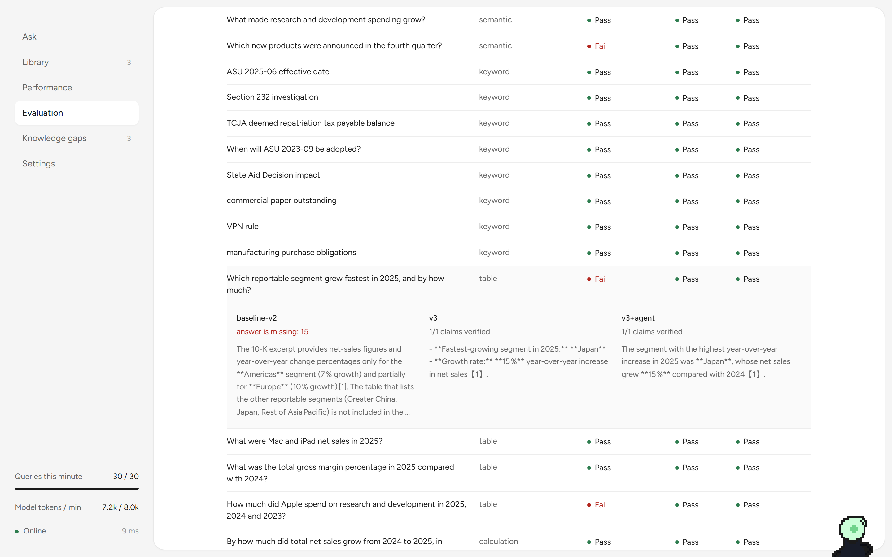

### Every retrieval setup

| Retrieval setup | Passed | Right chunk first | In top 5 | MRR | Unanswerable caught |
|---|---|---|---|---|---|
| v2: fixed 512-character chunks, vectors only | 33/40 | 50% | 89% | 0.65 | 25% |
| Structure-aware chunks, vectors only | 32/40 | 61% | 86% | 0.71 | 25% |
| BM25 keywords only | 33/40 | 58% | 86% | 0.70 | 50% |
| Hybrid (vectors + BM25, rank fusion) | 35/40 | 67% | 94% | 0.78 | 25% |
| Hybrid + contextual chunk headers | 36/40 | 72% | 97% | 0.82 | 25% |
| Hybrid + reranker | 39/40 | 83% | 97% | 0.87 | 100% |
| **Hybrid + contextual headers + reranker (default)** | **39/40** | **83%** | **97%** | **0.87** | **100%** |

The full per-question report, including every failure and the two documented re-grades, is in [evals/results/REPORT.md](evals/results/REPORT.md). How it is measured, what each part bought, and what still fails: [docs/EVALUATION.md](docs/EVALUATION.md).

Reproduce it:

```bash
python evals/run_evals.py             # retrieval: free, about a minute on a laptop
python evals/run_evals.py --answers   # answers: uses your LLM key
```

---

## What makes it different

| Capability | What it does | Why it matters |
|---|---|---|
| **Hybrid retrieval** | Vector search and BM25 keyword search in one Qdrant query, merged by reciprocal rank fusion | Paraphrases *and* exact codes like `ASU 2025-06`: exact-term questions 11/11 |
| **Contextual chunk headers** | Every chunk of **every uploaded file** is indexed with its document title and section. PDFs use their embedded title; headings are found even when a PDF has no blank lines | A chunk saying "limit is 260 euros" is found for "hotel limit in Paris" because it is indexed under "Travel Policy › Hotels" |
| **Cross-encoder reranking** | Re-scores three times as many candidates against the question | Right chunk first 72% → 83%, and the grounding label becomes trustworthy (4/4 unanswerable caught) |
| **Corrective re-search** | When the evidence is weak, the LLM rewrites the question in the documents' own wording and searches again | Rescues paraphrases that share no words with the text |
| **Answer verification** | Every cited claim is checked against only the chunk it cites; an unsupported claim triggers one rewrite, which is checked again | Catches the case retrieval scores can't: the right chunk, misread. Badges show "3/3 claims verified" |
| **Agent tools** | The model calls a calculator for every sum, share or percentage, and can search again mid-answer. Each step is shown | Exact, auditable arithmetic. The calculator only evaluates arithmetic and cannot run code |
| **Structure-aware chunking** | Tables stay whole with their caption; headings travel with their text | v2 cut Apple's segment table in half and answered wrongly. Table questions: 2/4 → 4/4 |
| **Charts and tables** | Answers that compare numbers can include a chart, drawn with [OpenUI](https://www.openui.com) | Display-only components, and only numbers from the sources |
| **Cost control** | Per-answer cost, an answer cache, budgets, low reasoning effort, free local models | See [COSTS.md](docs/COSTS.md) |
| **Measured** | A 40-question evaluation at retrieval and answer level, with per-question results in the app | Every claim on this page is reproducible |

---

## Screenshots

| | |
|---|---|
|  **Ask.** Suggestions come from the library. |  **Sources.** Each one says whether it was found by meaning, keywords or both, plus its rerank relevance. |
|  **Agent tools.** The calculation is done by a tool and shown, not guessed. "1/1 claims verified" is the self-check. | 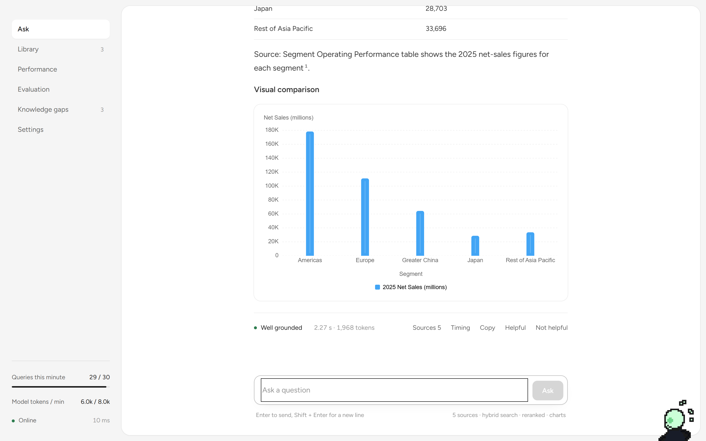 **Charts.** Numbers from the cited table, drawn with OpenUI. |
| 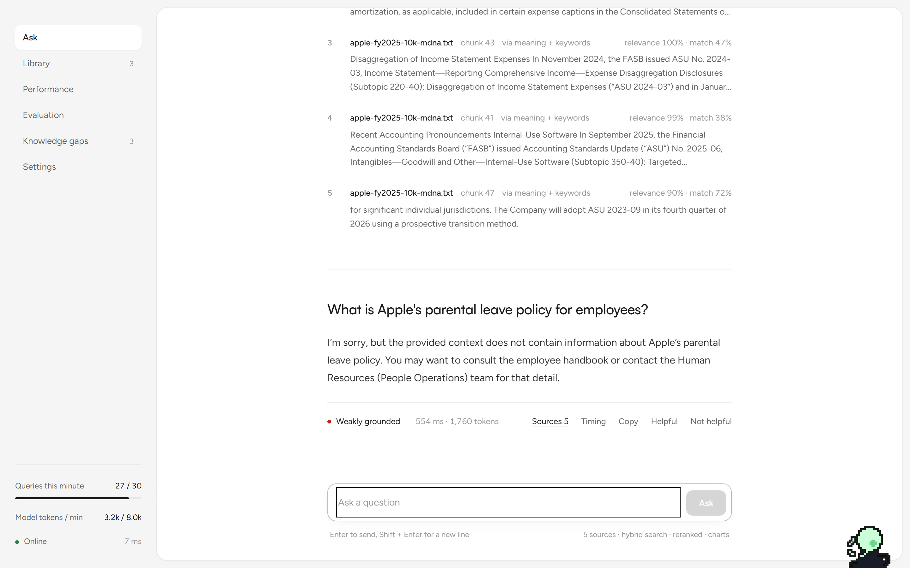 **Honest refusal.** Not in the documents: weakly grounded, declined, logged as a knowledge gap. | 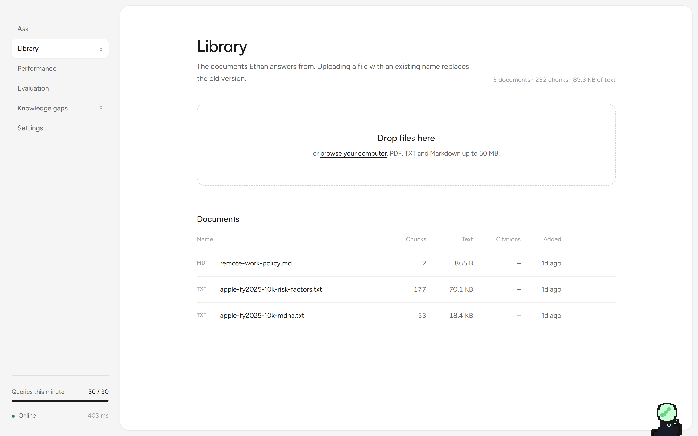 **Library.** PDF, Markdown and text. Preview every chunk and see which get cited. |
| 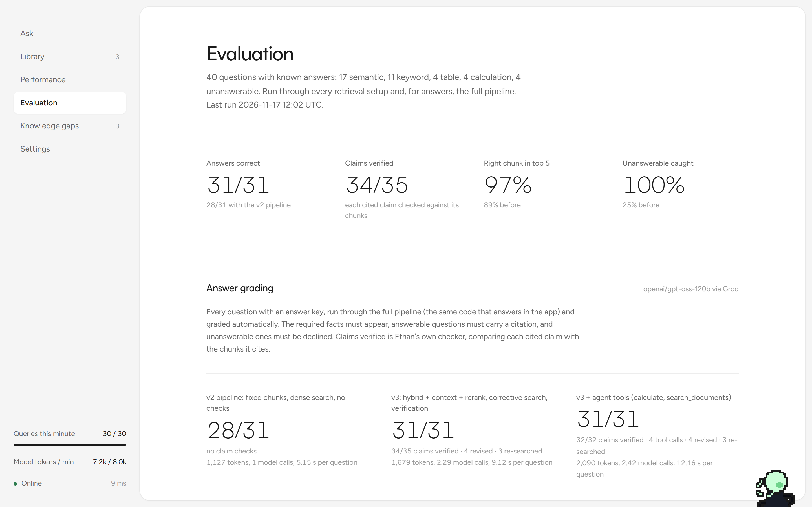 **Answer grading** in the app, per pipeline level. | 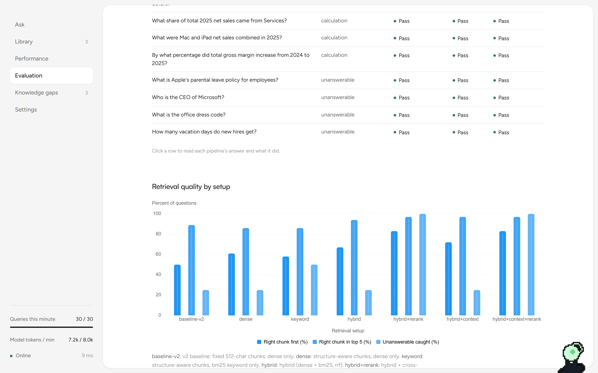 **Retrieval quality** for every setup. |
| 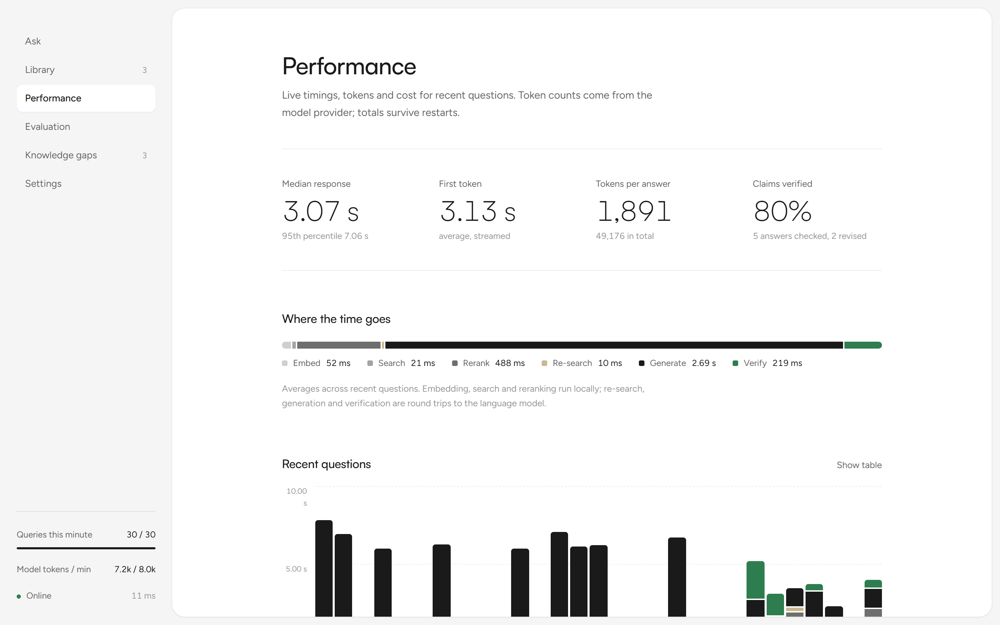 **Performance.** Latency per stage, including re-search and verification. | 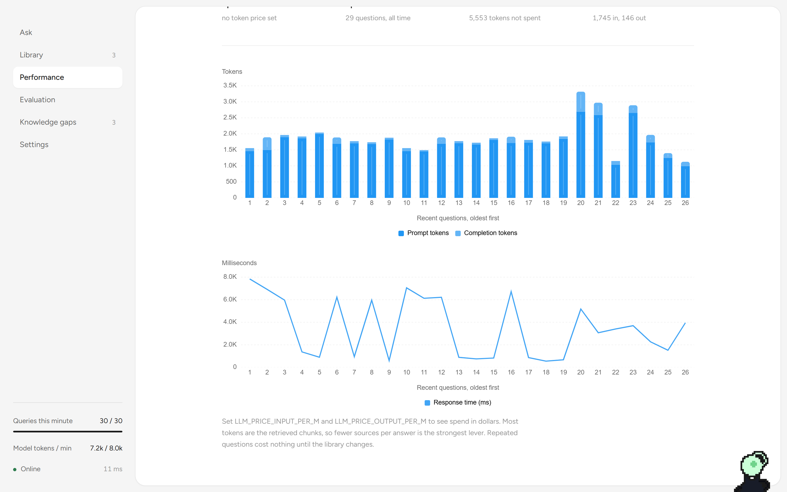 **Tokens and cost.** Per question, lifetime, and what the cache saved. |
| 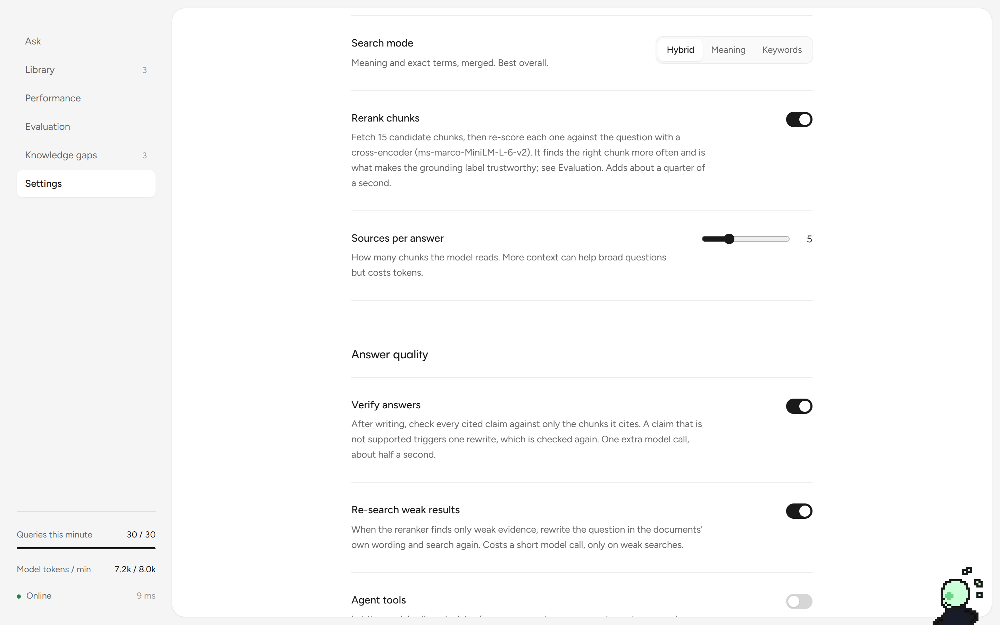 **Settings.** Search mode, reranking, verification, re-search and agent tools, each with its cost. | 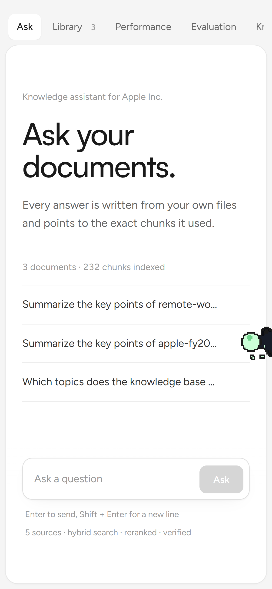 **Phone layout.** |

---

## How a question is answered

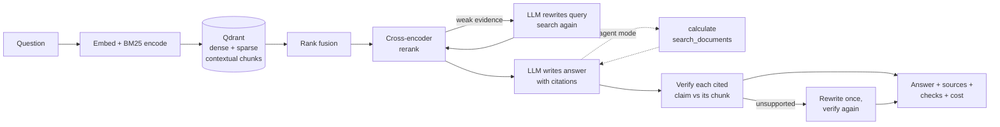

- **Local and free:** embedding, keyword encoding, search and reranking run on your CPU.
- **Sent to the LLM:** only the question and the selected chunks. With a local model (Ollama, vLLM), nothing leaves the machine.
- **Streaming:** the answer arrives over Server-Sent Events with live stages ("Searching", "Writing", "Checking each claim").

**Ingestion**, for any PDF, TXT or Markdown file:

1. The file is parsed.
2. It is split along its structure. Headings are found even without blank lines (typical of PDFs), and tables stay whole.
3. Each chunk is prefixed with its document title (a PDF's embedded title when present) and section.
4. Each chunk is embedded and BM25-encoded.

Files uploaded before contextual headers existed are upgraded in place with `python scripts/reindex_context.py`.

---

## Getting started

**Prerequisites:**

- Python 3.11 or 3.12
- Node.js 20 or later
- A free Groq API key from <https://console.groq.com>, **or** a local model server such as [Ollama](https://ollama.com)

Docker is optional: Qdrant runs embedded by default.

```bash
git clone https://github.com/ichor-hash/Wally.git ethan && cd ethan

# Backend
python -m venv venv
venv\Scripts\activate                     # macOS/Linux: source venv/bin/activate
pip install torch==2.14.1 --index-url https://download.pytorch.org/whl/cpu   # CPU build, ~10x smaller
pip install -r requirements.txt
copy .env.example .env                    # macOS/Linux: cp; then add GROQ_API_KEY
python -m uvicorn main:app --port 8001

# Frontend, in a second terminal
cd ethan-frontend
npm install
npm run dev
```

Open <http://localhost:3000>, drag the files from `demo/` into **Library**, and try these:

- *"Which reportable segment grew fastest in 2025?"*
- *"What share of total 2025 net sales came from Services?"* (with **Agent tools** on in Settings)
- *"What is Apple's parental leave policy?"* (it should decline)

Checks:

```bash
pip install -r requirements-dev.txt && pytest -q tests   # 52 unit tests, no downloads or API key
python evals/run_evals.py                                # retrieval evaluation
```

Deploying (Docker Compose, managed services, Kubernetes, fully private): [docs/HOSTING.md](docs/HOSTING.md). Day-to-day commands: [docs/RUNBOOK.md](docs/RUNBOOK.md).

---

## Configuration

Environment variables, read from `.env`. [`.env.example`](.env.example) lists every one.

| Variable | Default | Purpose |
|---|---|---|
| `LLM_PROVIDER` | `groq` | `groq`, `openrouter` or `openai_compatible` (Ollama, LM Studio, vLLM, llama.cpp) |
| `LLM_MODEL` | `openai/gpt-oss-120b` on Groq | Model; `openai/gpt-oss-20b` is faster and cheaper |
| `GROQ_API_KEY` / `OPENROUTER_API_KEY` / `LLM_BASE_URL` | | Provider access |
| `QDRANT_PATH` | | Embedded Qdrant in this folder, with no server |
| `QDRANT_URL` / `QDRANT_API_KEY` / `QDRANT_COLLECTION` | `localhost:6333` / / `ethan_docs` | Qdrant server or Qdrant Cloud |
| `RETRIEVAL_MODE` | `hybrid` | `hybrid`, `dense` or `keyword` |
| `CONTEXTUAL_RETRIEVAL` | `header` | `off`, `header` (title + section, free) or `llm` (adds a one-call-per-document summary) |
| `CHUNK_STRATEGY` / `CHUNK_SIZE` / `CHUNK_OVERLAP` | `structure` / `512` / `50` | Chunking |
| `VERIFY_ANSWERS` / `REVISE_ANSWERS` | `true` / `true` | Check every cited claim; rewrite once on failure |
| `CORRECTIVE_RETRIEVAL` | `true` | Rewrite and re-search weak retrievals |
| `LLM_PRICE_INPUT_PER_M` / `LLM_PRICE_OUTPUT_PER_M` | `0` | USD per million tokens, for cost tracking |
| `LLM_REASONING_EFFORT` | `low` | For `gpt-oss` models |
| `MAX_CONTEXT_CHARS` / `MAX_OUTPUT_TOKENS` | `8000` / `1024` | Budgets |
| `ANSWER_CACHE_TTL` / `ANSWER_CACHE_SIZE` | `3600` / `256` | Answer cache; a TTL of `0` turns it off |
| `RATE_LIMIT` / `CORS_ORIGINS` | `30` / localhost | Per-client limit; allowed web origins |
| `ALLOW_DIRECTORY_INGEST` / `INNGEST_ENABLED` | `false` / `false` | Server-folder import; background jobs |

Per user, in the app's Settings: search mode, reranking, verification, re-search, agent tools, charts, sources per answer and streaming.

---

## API

| Method | Path | Description |
|---|---|---|
| `POST` | `/search` | Answer a question: answer, sources, grounding, verification, agent steps, correction, metrics |
| `POST` | `/search/stream` | Same, as Server-Sent Events: `stage`, `sources`, `token`, `tool`, `verification`, `revision`, `complete` |
| `POST` | `/ingest/pdf` | Upload a PDF, TXT or MD file |
| `GET` | `/documents` · `/documents/{name}/chunks` | Library, and the chunks of one document with section and usage |
| `DELETE` | `/documents/{name}` | Remove a document |
| `GET` | `/health` · `/metrics` · `/evals` · `/insights` | Status and configuration · latency, tokens, cost, verification · evaluation report · knowledge gaps |
| `POST` | `/feedback` · `/reranker/warmup` | Rate an answer · preload the reranker |

```json
POST /search
{ "query": "What share of 2025 net sales came from Services?", "top_k": 5, "rerank": true, "mode": "hybrid",
  "agent": true, "verify": true, "correct": true, "visuals": false, "history": [] }
```

---

## Project structure

```
├── main.py              API: endpoints, streaming, ingestion, cache, cost
├── answering.py         The answer pipeline: retrieve → generate or agent → verify → revise
├── pipeline.py          Retrieval: hybrid search, rerank, corrective re-search
├── vector_db.py         Qdrant: dense + BM25 vectors, rank fusion, server or embedded
├── contextual.py        Contextual chunk headers (title, section, optional LLM summary)
├── verify.py            Claim extraction and verification, revision prompt
├── tools.py             Agent tools and the safe arithmetic evaluator
├── sparse.py            BM25 encoder
├── data_loader.py       PDF/TXT/MD loading, structure-aware chunking, heading detection
├── reranker.py, embeddings.py, llm.py, costs.py, telemetry.py
├── evals/               Golden questions, harness, committed results and run logs
├── tests/               52 unit tests (fake models, no network)
├── scripts/             migrate_collection.py (v2 → hybrid), reindex_context.py (add headers to old uploads)
├── docs/                Evaluation, hosting, costs, runbook, demo script, screenshots
├── Dockerfile, docker-compose.yml
└── ethan-frontend/      Next.js app: Ask, Library, Performance, Evaluation, Knowledge gaps, Settings
```

---

## Design decisions

- **Measure every change.** Each feature was kept or tuned on the evaluation's numbers. For example, the reranker reads plain chunk text because reading the contextual header too cost a top-1 hit.
- **Trust, then verify.** Retrieval scores say whether relevant text was found. Only a claim-level check says whether the answer used it faithfully, so Ethan does both and shows both.
- **Tools for maths, not prompts.** "Be careful with arithmetic" is a request; `calculate()` is a guarantee, and its result is shown.
- **Correct only when needed.** Re-search and revision run only when evidence is weak or a claim fails, so strong questions pay nothing extra for them.
- **Works on any file.** Contextual headers, structure-aware chunking and heading detection apply to every upload, not tuned to the demo documents. A test PDF with no blank lines gets one chunk per section, each labelled.
- **Honest by default.** Failures, false alarms and re-grades are documented next to the successes.

---

## Limitations

| Limitation | Next step |
|---|---|
| No user accounts or document permissions | SSO in front of the API, per-team collections ([HOSTING.md](docs/HOSTING.md#before-you-expose-it-to-a-network)) |
| Tables inside PDFs come out as plain text | Layout-aware PDF parsing |
| The verifier uses the same model family that wrote the answer | A separate judge model or an NLI model as a second opinion |
| Verification roughly doubles answer latency on the free tier | Turn it off per user, or run on a faster provider |
| Scanned PDFs have no text | OCR on ingestion |
| English-only embedding model | Multilingual embeddings such as `bge-m3` |
| Telemetry and cache live in one process | Postgres or Redis for multi-replica deployments |

## Roadmap: an audited System 1

The LLM is called for four jobs, and only one of them, writing the answer, needs a generative model. The other three are decisions: "is this evidence enough?", "does this passage support this claim?".

The planned next architecture puts a fast, non-generative **System 1** in front of the LLM for those decisions:

- an exact-key claim ledger;
- a deterministic numbers-and-terms check;
- a local NLI verifier, optionally TypeSafe's Jev.

Only the claims System 1 can't settle go to the LLM. A small random audit stream keeps an unbiased, human-anchored error estimate. When a document changes, only the decisions that touch changed chunks are re-certified, and past answers that cited them are flagged as outdated.

The design came out of a research round and a three-judge review covering novelty, engineering and statistics. That review is written up in [docs/FUTURE.md](docs/FUTURE.md), including what is new, what is prior work, the sample sizes needed, and the phased build plan.
