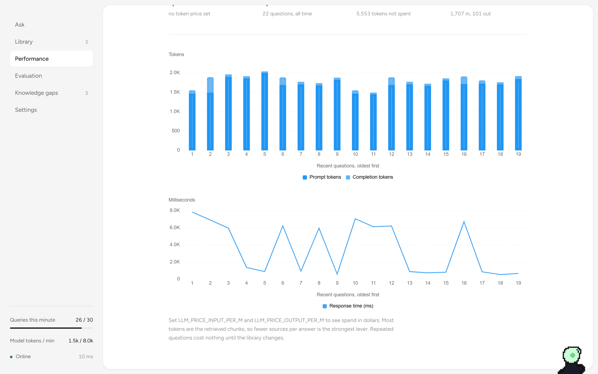

# Running costs

Everything except answer generation runs locally and costs nothing per question: embeddings, BM25, vector search and reranking. The language model is the only metered part, so cost control means sending it fewer tokens and calling it less often.



## Where the tokens go

Measured over the 27 graded answers in the evaluation (`gpt-oss-20b`, 5 sources per answer):

| | Before | After | Change | Cause |
|---|---|---|---|---|
| Prompt tokens per answer | 954 | 826 | −13% | Structure-aware chunks are smaller, and the context budget trims the tail |
| Completion tokens per answer | 224 | 78 | −65% | `reasoning_effort=low` |
| Answers correct | 24/27 | 27/27 | | Hybrid retrieval, reranking and table-aware chunks |

- **Most of the prompt is the retrieved chunks.** The system prompt is a couple of hundred tokens and the question a dozen or so.
- Completion fell because `gpt-oss` models reason before answering, and those hidden reasoning tokens are billed. Ethan now asks for `reasoning_effort=low`. Grounded Q&A over five chunks needs little deliberation, and the evaluation showed no loss in accuracy: the same 27 questions went from 24 to 27 correct.
- The low setting also fixed a real failure. On the provider's default effort, one answer spent its entire output budget on reasoning and came back empty.

## The controls

| Setting | Default | Effect |
|---|---|---|
| Answer cache | `ANSWER_CACHE_TTL=3600`, `ANSWER_CACHE_SIZE=256` | A repeated question is answered with no embedding, search or LLM call. Entries are keyed on the question, settings, conversation history and index version, so any upload or delete invalidates them all. A cached answer can never cite a stale document. |
| Context budget | `MAX_CONTEXT_CHARS=8000` | The lowest-ranked chunks are dropped once the context would exceed this. It caps the prompt even when someone sets 15 sources. |
| Output budget | `MAX_OUTPUT_TOKENS=1024` | Hard ceiling on completion tokens, reasoning included. |
| Reasoning effort | `LLM_REASONING_EFFORT=low` | For `gpt-oss` models. Raise it only if your evaluation shows a gain. |
| Temperature | `LLM_TEMPERATURE=0.2` | Lower means fewer rambling answers and more cache-friendly wording. |
| Sources per answer | 5 (in the app's settings) | The strongest lever. Each extra source adds about 100 prompt tokens. |
| Charts and tables | Off by default | Adds about 700 prompt tokens, because the OpenUI instructions are sent with the question. Turn it on for analysts, not for everyone. |
| Reranking | On | Free per question (local CPU, about 0.25 s). It lets you send *fewer* sources, because the right chunk is first 91% of the time. |
| Local model | `LLM_PROVIDER=openai_compatible` | Zero marginal cost. See [HOSTING.md](HOSTING.md#option-5-fully-private-local-model). |

The cache scope is deliberate. A follow-up asked inside a conversation includes that conversation's history in its key, so it is never answered with a reply written for a different context. The hits come from people asking the same standalone question, which is common for policy and FAQ content.

## Seeing spend

Set your provider's prices, in US dollars per million tokens, from its pricing page:

```env
LLM_PRICE_INPUT_PER_M=0.10
LLM_PRICE_OUTPUT_PER_M=0.50
```

Those two values are placeholders. Prices change and differ by provider and model, so copy the current ones.

With prices set:

- Every answer shows its cost under the answer.
- **Performance → Tokens and cost** shows cost per question, cost per 1,000 questions, lifetime spend, cache hit rate and tokens saved.
- Totals are persisted in `ethan_data/insights.json`, so they survive restarts.

## Estimating a monthly bill

```
monthly cost ≈ questions per month × (1 − cache hit rate)
               × (prompt_tokens × input_price + completion_tokens × output_price) / 1,000,000
```

Worked example: 200 employees, 10 questions each per working day, about 44,000 questions a month. Assume a 20% cache hit rate, the measured 826 + 78 tokens per answer, and the placeholder prices above:

```
44,000 × 0.8 × (826 × 0.10 + 78 × 0.50) / 1,000,000 ≈ $4.3 a month
```

Recalculate with your own prices; the Performance view does this from real traffic once they are set.

Two other costs matter more than tokens at small scale:

- **Free-tier rate limits.** Groq's free tier allows a fixed number of tokens per minute. At about 900 tokens per question, a few questions per minute is the ceiling. The sidebar shows the live quota, and Ethan queues questions instead of failing them.
- **Hosting.** The API needs about 2 GB of memory for the two local models; see [HOSTING.md](HOSTING.md).

## What did not change

Embedding and reranking stay local on CPU. The two models are 90 MB each, together about 175 MB on disk. A hosted embedding API would add a per-token cost for every upload and every question, and send every document to a third party, in exchange for a small quality gain. The evaluation is the place to check whether that trade is worth it for your documents.
