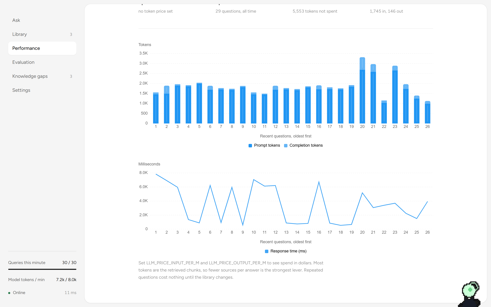

# Running costs

Everything except answer generation runs locally and costs nothing per question: embeddings, BM25, vector search and reranking. The language model is the only metered part, so cost control means sending it fewer tokens and calling it less often.



## Where the tokens go

Measured on the 31 graded answers in the evaluation (`gpt-oss-120b`, 5 sources per answer):

| Pipeline | Tokens / question | Model calls | Seconds (free tier) | Correct |
|---|---|---|---|---|
| v2: one call, no checks | 1,127 | 1.0 | 5.2 | 28/31 |
| **v3 default**: corrective re-search + verification | 1,679 | 2.3 | 9.1 | **31/31** |
| v3 + agent tools | 2,090 | 2.4 | 12.2 | 31/31 |

Where v3's extra ~550 tokens go:

- **Verification**: one call per answer that has citations, with the claims plus only the chunks they cite, typically 400 to 600 tokens. This is most of the difference.
- **Revision**: only when a claim fails the check, in 4 of 31 answers here. It re-sends the conversation plus the checker's findings, then verifies again.
- **Corrective re-search**: a short call of about 100 tokens, only when retrieval evidence is weak (3 of 31 here).
- **Agent tools**: each tool round re-sends the context, so about +400 tokens per question that uses a tool.

Two earlier savings still hold:

- **Most of the prompt is the retrieved chunks.** The system prompt is a couple of hundred tokens, the question a dozen or so.
- **`reasoning_effort=low`.** `gpt-oss` models reason before answering, and those hidden tokens are billed. In an earlier run on `gpt-oss-20b`, completion tokens fell from 224 to 78 per answer with no loss in accuracy. It also fixed a real failure: on the default effort, one answer spent its whole output budget on reasoning and came back empty.

## Cutting it further

Three savings that do not touch answer quality:

**Near-irrelevant chunks are left out** (`CONTEXT_PRUNE_RATIO=0.01`). After reranking, a strong question usually has one or two chunks scoring near 1.0 and a tail scoring near 0. For example, `k06` scores 0.997, then 0.000 four times. Chunks below 1% of the best score are not sent, and the best two always are. When the best score is weak, everything is sent, because the reranker is unsure: in `s15` every chunk scores 0.000 and the first one is still the right one.

Measured on the 31 graded questions:

| | Before | Pruned |
|---|---|---|
| Context characters sent (all 40 questions, retrieval only) | 100% | 81% |
| Chunks a question needs that were dropped | none | none |
| Prompt tokens per answer (v3, live run) | 1,412 | 1,186 (−16%) |
| Cost per answer at $0.15 / $0.60 per M | $0.000384 | $0.000343 (−11%) |
| Answers correct | 30/30 | 30/30 |

The live run used a 2% cutoff; the default is 1%, which keeps a borderline chunk (0.019) one answer drew on, for one point less saving. One question hit the free-tier limit and is left out of both columns. Set `CONTEXT_PRUNE_RATIO=0` to always send every chunk.

**The checks can run on a smaller model** (`CHECK_MODEL`). The fact-check and the corrective query rewrite are short, structured tasks: compare a claim with a passage, rephrase a query. They are most of v3's extra *output* tokens, which cost four times as much as input on `gpt-oss-120b`. With `CHECK_MODEL=openai/gpt-oss-20b` they cost about half as much, and on Groq's free tier they draw on that model's separate daily quota. Answers are still written by `LLM_MODEL`. Each call is priced at its own model's rate (`CHECK_PRICE_INPUT_PER_M`, `CHECK_PRICE_OUTPUT_PER_M`). The check model has not been graded yet: run `python evals/run_evals.py --answers --levels v3` with it set and compare the claims-verified figure before relying on it.

**More repeated questions hit the cache.** The cache key ignores case, punctuation, articles and was/were, so "What were total net sales in 2024?" and "what was total net sales in 2024" share one answer. Every other word still counts, including years, numbers, *not*, *maximum* and *minimum*, and question words. Similarity matching was tested and rejected: with the embedding model, "net sales in 2024" and "net sales in 2023" are 0.977 similar, more than many true paraphrases, so a similarity cache would return the wrong year's answer.

**Turning the answer checks off** should bring the token count back near v2's while keeping the better retrieval (not separately measured). The retrieval improvements are free per question; the answer checks are what cost tokens. In Settings, each user can turn off **Verify answers** and **Re-search weak results**, and switch on **Agent tools** only when needed.

## The controls

| Setting | Default | Effect |
|---|---|---|
| Answer cache | `ANSWER_CACHE_TTL=3600`, `ANSWER_CACHE_SIZE=256` | A repeated question is answered with no embedding, search or LLM call. Entries are keyed on the question, settings, conversation history and index version, so any upload or delete invalidates them all. A cached answer can never cite a stale document. |
| Context pruning | `CONTEXT_PRUNE_RATIO=0.01` | Leaves out chunks scoring below 1% of the best one, when the best is strong. −16% prompt tokens, no answer lost. |
| Check model | `CHECK_MODEL` (empty) | A smaller model for fact-checks and query rewrites, for example `openai/gpt-oss-20b`. Grade it first. |
| Context budget | `MAX_CONTEXT_CHARS=8000` | The lowest-ranked chunks are dropped once the context would exceed this. It caps the prompt even when someone sets 15 sources. |
| Output budget | `MAX_OUTPUT_TOKENS=1024` | Hard ceiling on completion tokens, reasoning included. |
| Reasoning effort | `LLM_REASONING_EFFORT=low` | For `gpt-oss` models. Raise it only if your evaluation shows a gain. |
| Temperature | `LLM_TEMPERATURE=0.2` | Lower means fewer rambling answers and more cache-friendly wording. |
| Sources per answer | 5 (in the app's settings) | The strongest lever. Each extra source adds about 100 prompt tokens. |
| Charts and tables | Off by default | Adds about 700 prompt tokens, because the OpenUI instructions are sent with the question. Turn it on for analysts, not for everyone. |
| Reranking | On | Free per question (local CPU, about 0.25 to 0.5 s). It lets you send *fewer* sources, because the right chunk is first 83% of the time. |
| Verify answers | `VERIFY_ANSWERS=true`, per user in Settings | One extra call per answer, the largest share of v3's extra tokens. Worth it where a wrong number is expensive. |
| Revise answers | `REVISE_ANSWERS=true` | Runs only when a claim fails verification. |
| Re-search weak results | `CORRECTIVE_RETRIEVAL=true`, per user in Settings | A ~100-token call, only when evidence is weak. |
| Agent tools | Off; per user in Settings | About +400 tokens per question that uses a tool. |
| Contextual headers | `CONTEXTUAL_RETRIEVAL=header` | Free. `llm` adds one summary call per uploaded document, not per question. |
| Model | `LLM_MODEL=openai/gpt-oss-120b` | `openai/gpt-oss-20b` is faster and cheaper per token. Grade it with `python evals/run_evals.py --answers` before switching. |
| Local model | `LLM_PROVIDER=openai_compatible` | Zero marginal cost. See [HOSTING.md](HOSTING.md#option-5-fully-private-local-model). |

The cache scope is deliberate. A follow-up asked inside a conversation includes that conversation's history in its key, so it is never answered with a reply written for a different context. The hits come from people asking the same standalone question, which is common for policy and FAQ content.

## Seeing spend

Set your provider's prices, in US dollars per million tokens, from its pricing page:

```env
LLM_PRICE_INPUT_PER_M=0.10
LLM_PRICE_OUTPUT_PER_M=0.50
```

Those two values are placeholders. Prices change and differ by provider and model, so copy the current ones.

With prices set:

- Every answer shows its cost under the answer.
- **Performance → Tokens and cost** shows cost per question, cost per 1,000 questions, lifetime spend, cache hit rate and tokens saved.
- Totals are persisted in `ethan_data/insights.json`, so they survive restarts.

## Estimating a monthly bill

```
monthly cost ≈ questions per month × (1 − cache hit rate)
               × (prompt_tokens × input_price + completion_tokens × output_price) / 1,000,000
```

Worked example: 200 employees, 10 questions each per working day, about 44,000 questions a month. Assume a 20% cache hit rate, the measured 1,679 tokens per answer (1,397 in, 282 out), and the placeholder prices above:

```
44,000 × 0.8 × (1,397 × 0.10 + 282 × 0.50) / 1,000,000 ≈ $9.9 a month
```

Recalculate with your own prices; the Performance view does this from real traffic once they are set.

Two other costs matter more than tokens at small scale:

- **Free-tier rate limits.** Groq's free tier allows 8,000 tokens per minute and 200,000 per day per model. At about 1,700 tokens per question that is four to five questions a minute and roughly 115 a day. The sidebar shows the live quota, and Ethan queues questions instead of failing them.
- **Hosting.** The API needs about 2 GB of memory for the two local models; see [HOSTING.md](HOSTING.md).

## What did not change

Embedding and reranking stay local on CPU. The two models are 90 MB each, together about 175 MB on disk. A hosted embedding API would add a per-token cost for every upload and every question, and send every document to a third party, in exchange for a small quality gain. The evaluation is the place to check whether that trade is worth it for your documents.
