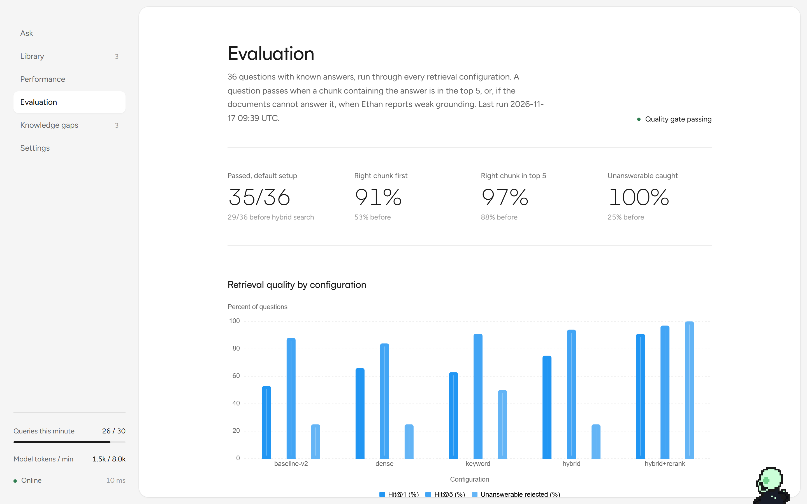

# Evaluation

Ethan is measured, not described. Every change to retrieval runs against a fixed set of questions with known answers, and the results, failures included, are committed in [`evals/results/REPORT.md`](../evals/results/REPORT.md), shown in the app's **Evaluation** view, and checked by CI on every push.



## What is tested

[`evals/golden.json`](../evals/golden.json) holds **36 questions** over three documents: the Apple FY2025 10-K Risk Factors and MD&A sections in `demo/`, and the sample remote-work policy.

| Type | Count | What it catches |
|---|---|---|
| Semantic | 17 | Paraphrased questions with little word overlap ("What could happen if hackers break into the company's systems?") |
| Keyword | 11 | Exact identifiers that embeddings blur: `ASU 2025-06`, `Section 232`, `TCJA`, `iPhone 16e` |
| Table | 4 | Answers that need a complete table: the fastest-growing segment, R&D spend over three years |
| Unanswerable | 4 | Questions the documents cannot answer: parental leave, dress code, Microsoft's CEO |

Relevance is labelled by **phrases**, not chunk ids: a chunk is relevant if it contains every phrase in one of the case's groups. Labels therefore survive re-chunking, and the same golden set can compare chunking strategies fairly. The harness also flags any label that no chunk can satisfy, so an unreachable label is reported as a chunking limitation rather than silently counted as a retrieval miss.

## Two levels

**Retrieval** (`python evals/run_evals.py`, no API key, about a minute on a laptop CPU). It builds an in-memory index from the demo corpus and runs each question through five configurations, using the same `pipeline.py` the API serves:

- A question **passes** if a chunk containing the answer is in the top 5.
- An unanswerable question passes if retrieval reports *weak grounding* (best cosine below 0.25, or best rerank relevance below 0.30). That is what makes the UI warn the user and log a knowledge gap.

**Answers** (`python evals/run_evals.py --answers`, needs an LLM key). It generates real answers with the API's own prompt and grades them automatically:

- Required facts must appear (regular expressions, e.g. `Japan` and `15`).
- Answerable questions must carry a `[n]` citation.
- Unanswerable questions must be declined.

## Results

### Retrieval

| Configuration | Passed | Right chunk first | Right chunk in top 5 | MRR | Unanswerable caught | Latency |
|---|---|---|---|---|---|---|
| v2 baseline: fixed 512-char chunks, dense only | 29/36 | 53% | 88% | 0.67 | 25% | 10 ms |
| Structure-aware chunks, dense only | 28/36 | 66% | 84% | 0.74 | 25% | 10 ms |
| Structure-aware chunks, BM25 keyword only | 31/36 | 62% | 91% | 0.73 | 50% | 12 ms |
| Structure-aware chunks, hybrid (dense + BM25, RRF) | 31/36 | 75% | 94% | 0.82 | 25% | 13 ms |
| **Hybrid + cross-encoder rerank (default)** | **35/36** | **91%** | **97%** | **0.93** | **100%** | 251 ms |

| Passed by type | semantic | keyword | table | unanswerable |
|---|---|---|---|---|
| v2 baseline | 16/17 | 10/11 | 2/4 | 1/4 |
| hybrid | 16/17 | 11/11 | 3/4 | 1/4 |
| hybrid + rerank | 16/17 | 11/11 | **4/4** | **4/4** |

### Answers (`openai/gpt-oss-20b` via Groq)

| Configuration | Correct | Prompt tokens | Completion tokens |
|---|---|---|---|
| v2 baseline | 24/27 | 954 | 84 |
| **Hybrid + rerank (default)** | **27/27** | **826** | **78** |

The v2 setup got three questions wrong. Two were tables and one was a list. The headline case: asked which segment grew fastest, v2 answered **"Europe, +10%"** and labelled it *well grounded*, which is wrong. The correct answer is Japan, +15%. v3 answers correctly because the segment table is now one chunk.

## What each change bought

- **Structure-aware chunking** fixed the table failures. Fixed 512-character windows had cut Apple's segment table between its caption and the Japan row, so no single chunk held the answer. Tables now stay whole with their caption and section heading. On its own this does not raise the dense-only pass count, because smaller paragraph chunks are harder to match by meaning; it pays off together with hybrid search.
- **BM25 keyword search** found every exact-identifier question (11/11). `iPhone 16e` is the clearest case: dense search ranked a table of iPad numbers first.
- **Reciprocal rank fusion** combines both rankings. It puts the right chunk first in 75% of cases, against 62% for keywords and 66% for meaning alone.
- **The cross-encoder reranker** is what makes the grounding label honest. Cosine similarity cannot separate "related" from "answers the question": the parental-leave question scores 0.39 against Apple's 10-K preamble. The reranker's relevance score drops to near zero for such cases, so all four unanswerable questions are caught, against one before. That is why reranking is on by default.

## Known failures, kept visible

- **`s12` "What is the risk if important employees leave?"** fails in every configuration. The relevant sentence ("the continued service and availability of highly skilled employees, including key personnel") shares no keyword with the question, and the embedding model ranks a natural-disasters passage higher. A larger embedding model is the likely fix (see the model notes in the README).
- **Answer `s17`** (fourth-quarter products) passed only after the chunker learned to keep a "Fourth Quarter 2025:" label with the list that follows it. It is a reminder that answer quality depends on chunk boundaries.
- **The grader is strict and literal.** A correct answer written as "a 15 percent rise" would fail a `15` regex check if the model spelled out the number. Read failures in the report before trusting a regression.

## In CI

`.github/workflows/ci.yml` runs the retrieval evaluation on every push and pull request:

- The job **fails** if hybrid + rerank drops below Hit@5 0.93, MRR 0.80 or 75% unanswerable caught, or if plain hybrid drops below Hit@5 0.90 or MRR 0.70.
- The thresholds sit a little under the measured numbers, so a real regression fails the build and run-to-run noise does not.
- The full pass/fail table appears on the run's summary page and is uploaded as the `eval-report` artifact.

The answer evaluation costs tokens, so it runs only on demand: **Actions → Answer evaluation → Run workflow**. Add a `GROQ_API_KEY` repository secret first.

## Adding cases

Add an entry to `evals/golden.json`:

```json
{"id": "k12", "category": "keyword", "question": "What is the VPN rule?",
 "relevant": [["VPN", "public networks"]], "answer": {"all": ["VPN"]}}
```

Then run `python evals/run_evals.py`. To evaluate your own documents, change `corpus` to point at them and write cases from questions your users actually ask. The **Knowledge gaps** view is a good source.
