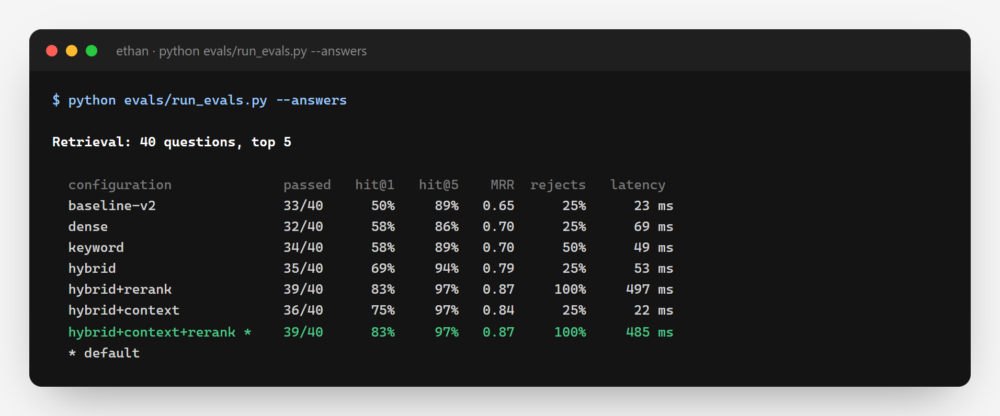
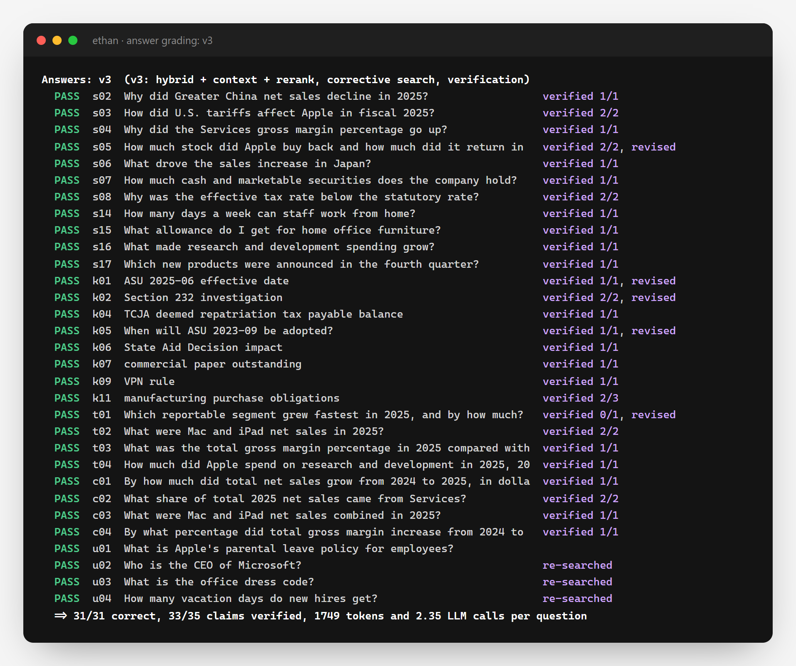
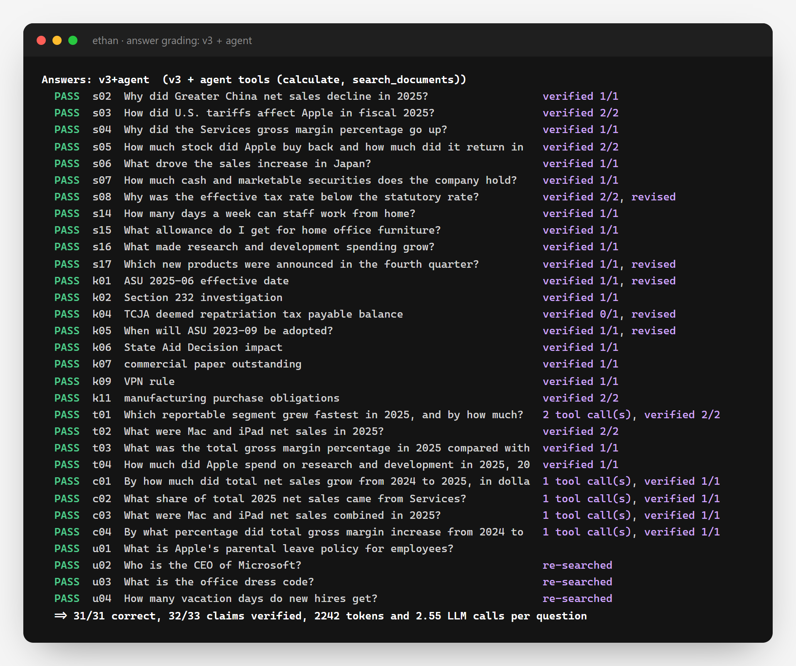
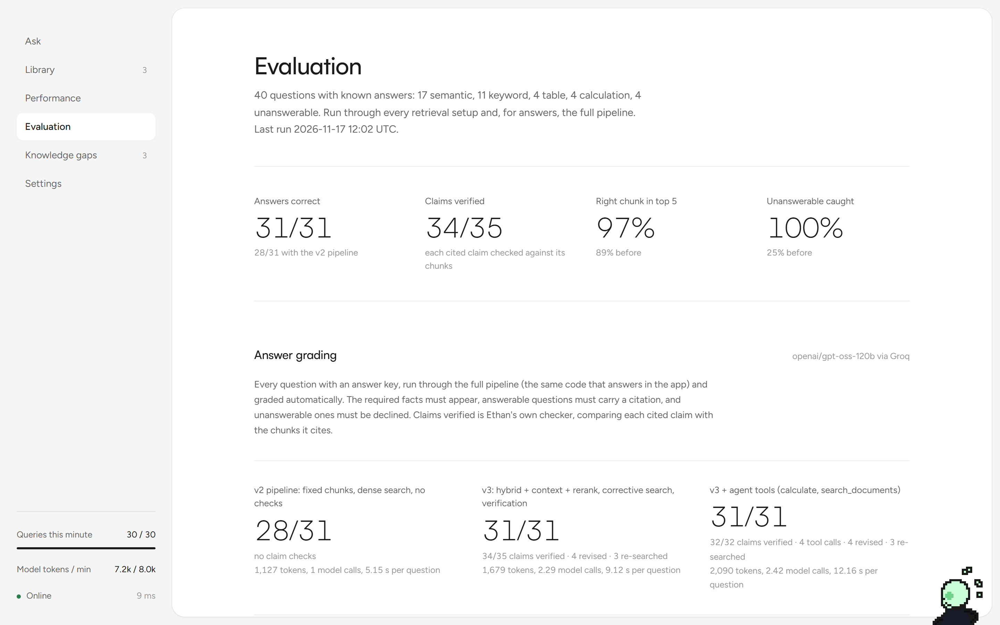
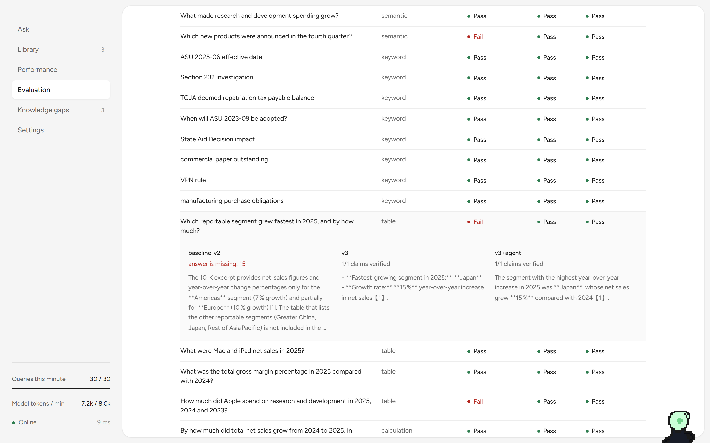

# Evaluation

Ethan is measured, not described. A fixed set of questions with known answers is run through every retrieval setup and through the full answering pipeline, and every result is committed:

- [`evals/results/REPORT.md`](../evals/results/REPORT.md): every case, passed and failed, with the reason.
- [`evals/results/latest.json`](../evals/results/latest.json): the raw report, shown in the app's **Evaluation** view.
- [`evals/results/run-answers.log`](../evals/results/run-answers.log): the console output of the run.

Last full run: **17 November 2026**, `openai/gpt-oss-120b` via Groq, CPU embeddings and reranker.

## Results at a glance

| | v2 pipeline | **v3 (default)** | v3 + agent tools |
|---|---|---|---|
| Answers correct | 28/31 | **31/31** | **31/31** |
| Claims verified against their sources | not checked | **34/35** | **32/32** |
| Right chunk ranked first (retrieval) | 50% | **83%** | 83% |
| Right chunk in the top 5 | 89% | **97%** | 97% |
| Unanswerable questions caught at retrieval | 1 of 4 | **4 of 4** | 4 of 4 |
| Tokens per question | 1,127 | 1,679 | 2,090 |
| Model calls per question | 1.0 | 2.3 | 2.4 |
| Seconds per question, free tier | 5.2 | 9.1 | 12.2 |

## The run







<details><summary>Answer grading, v2 pipeline (the baseline)</summary>


</details>

The same results in the app, where every graded answer can be opened and read:






## What is tested

[`evals/golden.json`](../evals/golden.json) holds **40 questions** over three documents: Apple's FY2025 10-K Risk Factors and MD&A sections (`demo/`), and a sample remote-work policy (`docs/samples/`).

| Type | Count | What it catches |
|---|---|---|
| Semantic | 17 | Paraphrases with little word overlap: "What could happen if hackers break into the company's systems?" |
| Keyword | 11 | Exact identifiers embeddings blur: `ASU 2025-06`, `Section 232`, `TCJA`, `iPhone 16e` |
| Table | 4 | Answers that need a whole table: the fastest-growing segment, R&D over three years |
| Calculation | 4 | Arithmetic on numbers in the documents: Services' share of sales, gross-margin growth |
| Unanswerable | 4 | Not in the documents: parental leave, dress code, Microsoft's CEO, vacation days |

31 of the 40 have an answer key and are used for answer grading; the other 9 test retrieval only.

## How it is graded

**Retrieval** (`python evals/run_evals.py`; no API key, about a minute on a laptop CPU). It builds in-memory indexes from the corpus and runs every question through seven setups, using the same `pipeline.py` the API serves.
- A question **passes** if a chunk containing the answer is in the top 5.
- Relevance is labelled by phrases, not chunk ids, so labels survive re-chunking.
- An unanswerable question passes if retrieval reports *weak grounding*. That is what makes the app warn the user and log a knowledge gap.

**Answers** (`python evals/run_evals.py --answers`; needs an LLM key). Each question goes through `answering.py`, the exact code behind `/search`, at three levels, and is graded automatically:
- Required facts must appear (regular expressions, e.g. `Japan` and `15`).
- Answerable questions must cite a chunk as `[n]`.
- Unanswerable questions must be declined.

The run also records what the pipeline did on each question: corrective re-searches, tool calls, the verifier's verdict on each claim, and revisions.

## What each part of v3 bought

| Change | Measured effect |
|---|---|
| **Structure-aware chunking** | Tables stay whole with their caption. Table questions: 2/4 → 4/4 at retrieval, 2/4 → 4/4 in answers. |
| **Hybrid search (BM25 + vectors, RRF)** | Exact-term questions 10/11 → 11/11. Right chunk in top 5: 89% → 94%. |
| **Contextual chunk headers** | Each chunk is indexed with its document title and section. Without the reranker: right chunk first 67% → 72%, in the top 5 94% → 97%. **With the reranker the effect on this set is nil** (83% either way). It stays on because it is free and helps the first-stage search; for very large libraries, that is where it matters. |
| **Cross-encoder reranking** | Right chunk first 72% → 83%. Unanswerable questions caught 1/4 → 4/4: cosine similarity cannot tell "related" from "answers the question", and the reranker can. |
| **Corrective re-search** | Re-searched 3 of 31 graded questions, all unanswerable ones. The rewritten search still found nothing that answers them, and all three were correctly declined. In a spot check it rescued the one retrieval failure (`s12`, "important employees leave" → "departure of key employees"). That question has no answer key, so it is not in the graded total. |
| **Answer verification** | 35 cited claims checked in v3: 34 supported, 1 partly supported, none unsupported. 4 of 31 drafts were rewritten after a claim failed the check, and every rewrite then passed. |
| **Agent tools** | 4 calculator calls, all exact. On `gpt-oss-120b` the arithmetic questions were already right without tools. On `gpt-oss-20b` (an earlier run), plain v3 got the gross-margin percentage wrong and the calculator fixed it. With a strong model the value is exact, auditable arithmetic shown under the answer. |

The v2 failures, for the record: it named the wrong segment and missed Japan's +15% (`t01`), dropped one year of the R&D series (`t04`), and missed AirPods Pro 3 from a product list (`s17`). All three were caused by chunks cutting through a table or list.

## Honest notes

- **One retrieval failure remains** without an LLM in the loop: `s12`, "What is the risk if important employees leave?". The relevant sentence ("key personnel") shares no words with the question, and the small embedding model ranks a natural-disasters passage higher. Corrective re-search finds it when it runs.
- **The verifier is strict, and was once wrong.** An early version checked the line "Growth rate: 15%" without the line above it naming Japan, compared it with *total* net sales growth (6%), and flagged it. Cited lines now carry the uncited lines directly above them as context. The two affected questions were re-graded (below).
- **Re-grades.** After the full run, two fixes touched a few questions, and those were re-run with `--only` instead of spending a full run's tokens. Everything else is from the full run.
  - Markdown headings directly above their text are now detected, which changed the policy document's chunks: `s14`, `s15`, `k09` were re-graded.
  - The claim-context fix above: `t01`, `k04` were re-graded.
  - Both re-grades kept every answer correct. The log of the latest one is [`run-answers-regrade.log`](../evals/results/run-answers-regrade.log).
- **The grader is literal.** A correct answer that spelled out "fifteen percent" would fail a `15` check. Read failures in the report before trusting a regression.
- **The checks cost time and tokens**: about 50% more tokens and 1.8 times the latency of the v2 pipeline on the free tier. [COSTS.md](COSTS.md) has the trade-offs and the switches.
- **Free-tier limits shape what can be run.** Groq's free tier allows 200,000 tokens per model per day, and a full three-level answer run uses about 150,000. The harness retries rate-limited calls. A call that still fails is recorded as an error, never as a wrong answer, and the provider's message is not stored.

## Running it

```bash
python evals/run_evals.py                          # retrieval, all seven setups (free)
python evals/run_evals.py --answers                # also grade answers at all three levels
python evals/run_evals.py --answers --levels v3    # one level
python evals/run_evals.py --answers --only t01,k04 # re-grade a few cases, keep the rest
python evals/run_evals.py --check                  # exit 1 if the default setup regresses
```

Use `LLM_MODEL` to grade a different model, for example `LLM_MODEL=openai/gpt-oss-20b`.

## Adding cases

Add an entry to `evals/golden.json`:

```json
{"id": "k12", "category": "keyword", "question": "What is the VPN rule?",
 "relevant": [["VPN", "public networks"]], "answer": {"all": ["VPN"]}}
```

To evaluate your own documents, point `corpus` at them and write cases from questions your users actually ask. The **Knowledge gaps** view is a good source. Questions that fail there are the ones worth adding.
