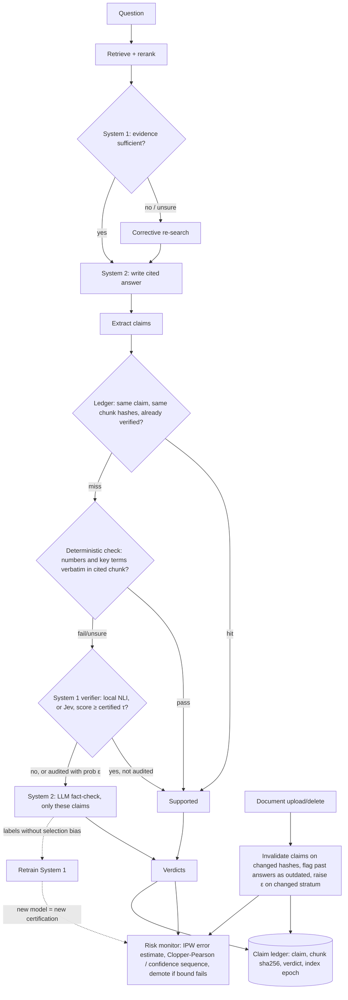

# Future enhancements and the System 1 architecture

This document covers where Ethan goes next:

- a ranked backlog of cost, quality and product ideas;
- the research on adding a fast "System 1" layer, with Jev (TypeSafe AI) as a candidate;
- the verdict of a review in which the candidate architectures were attacked on novelty, engineering and statistics.

It was written on 2026-11-17. Anything marked *planned* is not built yet.

## Contents

1. [Where Ethan stands](#where-ethan-stands)
2. [The System 1 question](#the-system-1-question)
3. [Research round: what already exists](#research-round-what-already-exists)
4. [Jev: what it is and where it fits](#jev-what-it-is-and-where-it-fits)
5. [The candidate architectures and the tribunal](#the-candidate-architectures-and-the-tribunal)
6. [The verdict: Audited System 1](#the-verdict-audited-system-1)
7. [Build plan](#build-plan)
8. [How it will be measured](#how-it-will-be-measured)
9. [Enhancement backlog](#enhancement-backlog)
10. [Considered and rejected](#considered-and-rejected)
11. [References](#references)

---

## Where Ethan stands

Ethan v3.1 retrieves with hybrid dense + BM25 search and a cross-encoder reranker. It corrects weak searches, fact-checks each cited claim with one LLM call, and revises unsupported answers once. On the 31 graded golden questions it is right 31/31 times and verifies 34 of 35 claims. It costs about 1,680 tokens and 2.3 LLM calls per question; context pruning has since cut prompt tokens by 16%. Details are in [EVALUATION.md](EVALUATION.md) and [COSTS.md](COSTS.md).

The LLM is called for four jobs:

| Job | Calls |
|---|---|
| Writing the answer | always |
| Rewriting a weak query | sometimes |
| Fact-checking the claims | almost always |
| Revising | rarely |

Only the first needs a generative model. The others are **decisions**: "is this evidence enough?", "does this passage support this claim?". That is what a System 1 layer is for.

## The System 1 question

The owner asked whether a "System One model" such as Jev could be added as a layer, and whether this could be a new architecture rather than a known one.

- **System 1** is fast and cheap. It makes typed decisions (yes/no, a choice, a score) in milliseconds, locally or for a fraction of a cent.
- **System 2** is the LLM: slow, expensive and general. It writes answers and handles whatever System 1 is unsure about.

The aim is for System 1 to take over as many decisions as it can, without making the answers worse, and to **prove** that it is not making them worse.

## Research round: what already exists

Four researchers covered:

- JEPA and LeCun's System 1 / System 2 framing;
- dual-process LLM systems, routers and cascades;
- learned memory and cheap verification;
- Jev and its open alternatives.

What they found:

**Already well covered, so not to be claimed as new:**
- fast/slow RAG with a router, including FD-RAG (2026), which uses the Kahneman framing directly;
- Adaptive-RAG query routing;
- Self-RAG claim checking and CRAG corrective search, both of which Ethan already does;
- Speculative RAG, where a small model drafts and a large one verifies;
- cost cascades: FrugalGPT, RouteLLM and AutoMix;
- conformal-guaranteed cascades (CompCRC, Conformal Cascade, BalanceRAG, RouteNLP);
- error-bounded semantic caches (vCache);
- students trained on LLM outputs (Cache & Distil, Distilling System 2 into System 1);
- conformal claim filtering (Conformal-RAG, CiteGuard);
- index-time claim compilation (PAQ/RePAQ, IndexRAG, "RAG Deserves an Index");
- JEPA-distilled retrievers (Rabtriever).

**Findings that shape the design:**
- **Decide after retrieval, not from the question.** Across more than 20k production queries, whether the LLM was needed could not be predicted from the query alone. A cheapest-first cascade run after retrieval served 72% of queries without the LLM. *The Coverage Illusion*, 2026.
- **Small local verifiers are nearly as good as frontier models.** On LLM-AggreFact, FactCG-DeBERTa-L (0.4B) scores 75.6 and MiniCheck-Flan-T5-L 75.0, against GPT-4o at 75.9. HHEM-2.1-Open runs on CPU in under 600 MB. All of them are weak on numbers and dates.
- **A confidence gate has not been shown to beat random routing.** In *Jev-as-a-Judge* (2026), a Jev → frontier-LLM cascade matched the frontier model at a third of the cost. But escalating the same share of claims **at random** did as well, and Jev alone accepted 23.2% of unsupported claims against the frontier model's 14.1%.
- **Pure JEPA on text is not established.** Squared-error latent prediction collapses on text (*The JEPA Paradox in Language*, 2026). The text variants that work, such as VL-JEPA and LLM-JEPA, use contrastive losses or paired views and give modest gains. JEPA-style prediction is a reasonable routing signal for Ethan, but not a way to state facts: MiniLM embeds "30 days" and "60 days" almost identically.
- **Ethan can't use model internals.** Groq exposes no weights, logits or hidden states. That rules out kNN-LM, Memory Decoder, xRAG, REFRAG, Cartridges and hidden-state probes unless Ethan moves to a self-hosted model.

## Jev: what it is and where it fits

Jev is TypeSafe AI's **non-generative "System One" model**, in early access since 2026-09-15; the current version is `jev-1.14.0`.

**How it works.** You send `POST /v1/systemone` with a *state* (text or JSON) and named *typed questions*, and get back typed answers with probabilities:
- `noul`: a probability;
- `choice`: 1 to 255 options;
- `score`: a 1 to 10 scale;
- `box`: image regions.

It never writes prose, extracts spans or explains itself.

**Limits.** It accepts 64k tokens per request. TypeSafe's published figures are $0.042 per million input tokens, free output and 70 to 500 ms per call; none has been checked independently.

**Weaknesses TypeSafe documents.**
- It reads questions literally.
- It is poor at maths, counting and dates.
- It is biased toward the first option.
- Prompt injection can come in through the state.
- Its "confidence" measures how concentrated the answer is, not how likely it is to be right.
- A separate paper (*Type-Safe Is Not Error-Free*, 2026) shows that an option's name can override its definition.

**Deployment.** It is hosted in the US. There is no data processing agreement, no zero-retention option and no self-hosting. Laya (ModernBERT, Apache-2.0) and Kev speak the same API, but they score far below Jev on some tasks, and Kev needs a GPU.

**Where Jev could take decisions in Ethan:**

| Decision | Fit | Risk |
|---|---|---|
| Corrective re-search trigger ("does this context answer the question?") | Good | Low: a miss costs one extra search |
| Routing, tool choice ("needs the calculator?"), chart choice | Good | Bias toward the first option; use neutral option names |
| Answerability: answerable / partial / not in the knowledge base | Medium | Refusing a question the knowledge base can answer |
| Per-claim verification | Weak today | Accepts 23% of unsupported claims; weak on numbers |
| Cache equivalence, contradictions at upload | Possible | A false "same question" serves a wrong answer |

**Verdict on Jev.** Jev can be **one backend behind a pluggable decider interface**, off by default. It is only for decisions that do not send confidential text, or for organisations that accept its data terms. The rest of the System 1 layer must work fully locally, because "everything but the LLM runs locally" is one of Ethan's design principles.

## The candidate architectures and the tribunal

Five candidates came out of the research. Three judges then attacked each one, working independently:
- a **prosecutor** searched for prior work that already does the "new" parts;
- an **engineering judge** read Ethan's code and judged fit, memory, latency and rollout;
- a **statistics judge** asked whether each candidate's claims could be measured honestly.

Scores are out of 10.

| Candidate | Idea | Novelty | Feasibility | Measurability |
|---|---|---|---|---|
| **C1 Audited amortization** | Every pipeline decision becomes a typed question answered by System 1. The LLM is the fallback and the teacher. Random audits keep an unbiased error estimate. Thresholds are re-certified after every retrain or reindex. A claim ledger is tied to chunk hashes. | 4 | **7** (scoped to claim checks) | **7** (with human anchors) |
| C2 Energy-landscape router | The cross-encoder is fine-tuned with an "energy" head on verdicts. It escalates when there is no low-energy evidence, or when several low-energy pieces of evidence disagree. | 3 | 4 | 3 |
| C3 Anticipation index | Likely questions and claims are generated at ingest; matching queries are answered with no LLM. | 1 | 5 | 6 |
| C4 Straight Jev integration | Jev handles the trigger, routing and tool decisions. | 0 | 3 | 7 |
| C5 Latent world model of the pipeline | LeCun's Mode-2 to Mode-1 idea: plan over the pipeline's actions. | 2 | 2 | 2 |

**What the prosecutor found:**
- No candidate is new as a mechanism.
- Random audits with inverse-propensity weighting are active, anytime-valid risk control (Xu et al., NeurIPS 2024; Zrnic & Candès, ICML 2024).
- Re-certifying when the corpus changes appears as "epochs" in recent conformal-RAG work.
- Invalidating answers on a document version change appears in FinCacheServe (2026), at the level of whole answers.
- Evidence disagreement as an escalation signal appears in ConflictRAG, EvidentialRAG and work that clusters passages before clarifying.
- C1 is the most defensible, **as an integration**.

**What the engineering judge found:**
- The labels C1 needs already exist and are thrown away.
  - `verify.verify_answer` produces a verdict for every claim on every answer.
  - Telemetry keeps only counts, and `queries.jsonl` is trimmed to 200 records on start.
  - Chunk IDs come from the clock, so a ledger needs a per-chunk `sha256` in the payload.
- The fact-check is called from one place in `Answerer.run`, so C1 fits cleanly behind flags.
- Shadow logging can start this week.
- The riskiest assumption: unsupported claims are rare (about 3%), so certifying anything takes a lot of traffic.
- Jev scores low on feasibility mainly because of data residency and because it is still in early access.

**What the statistics judge found:**
- The design is sound, but "certified" must mean **certified against human labels**. A bound against the LLM judge only measures agreement with the judge.
- The 31-question golden set cannot certify anything. Even 31/31 only bounds the error rate below 7.2% at 90% confidence.
- Sample sizes and estimators are in [How it will be measured](#how-it-will-be-measured).

## The verdict: Audited System 1

The tribunal's recommendation, merged with the backlog's deterministic check, is below.

### The architecture

There are three layers of System 1, cheapest first. Each covers the others' weak spots:

1. **Claim ledger: exact reuse.** If a claim was already verified against chunks with the same hashes, it is supported again, with no model call. It matches on exact keys only, never by similarity.
2. **Deterministic check.** The claim's numbers and key terms must appear verbatim in the cited chunk. This catches the "28,703 [1]" kind of claim, which is exactly where NLI models are weakest.
3. **Learned verifier.** A local int8 NLI model (HHEM-2.1-Open or FactCG-DeBERTa-L), or optionally Jev. It is accepted only above a threshold τ that has been certified on audited data.

Everything that is left goes to the LLM in **one smaller call**, holding only the unresolved claims. If nothing is left, the call is skipped.

### The audit stream

Even when System 1 is confident, each of its decisions is sent to System 2 with a small logged probability ε, which is never zero. That one random audit stream serves three purposes:

1. **An unbiased error estimate for accepted decisions.** Once System 1 accepts a claim, the teacher's label is never seen for it; the audit removes the selection bias this would otherwise cause.
2. **The calibration sample for re-certifying τ.**
3. **Training labels for retraining System 1, also free of selection bias.**

As a bonus, the logged propensities let any alternative threshold, and the "random routing" control, be evaluated offline without spending live traffic. That turns the *Jev-as-a-Judge* finding into a test Ethan runs on itself continuously: does the confidence gate beat random escalation on our own documents?

### Re-certification split by chunk hash

When documents change, most decisions still touch only unchanged chunks. The risk monitor splits decisions in two:

- decisions touching **unchanged** hashes keep their certificate;
- decisions touching **changed** hashes start a new one, with ε raised (0.3 to 1.0) on that slice until it re-certifies.

So an upload does not reset System 1 to zero. The same hashes invalidate ledger claims and flag past answers that cited changed chunks as **outdated**.

### What is and is not new

Per the prosecutor, claim only this:

> An engineering integration of active, anytime-valid risk control and epoch-based recalibration into a RAG pipeline, with one randomised audit stream doing three jobs: an unbiased error estimate per decision, the re-certification sample, and System 1 training data free of selection bias.
>
> Two parts we did not find in prior work, though search does not prove absence:
> - re-certification split by chunk hash, where an upload re-certifies only the slice of decisions that touch changed chunks;
> - claim-level invalidation of past answers.

The individual mechanisms are not new: inverse-propensity auditing, Learn-then-Test, conformal refresh and cascades. What we contribute is putting them together inside a RAG pipeline and showing honestly, with numbers, how it performs.

## Build plan

Every phase sits behind flags, is off by default, and is tested with fake models in the existing pytest style before any real traffic. These phases follow the engineering judge's plan.

**Phase 0: keep the labels (planned, can start now)**
- `decisions.py`, with a `DecisionLog` appending to `ETHAN_DATA_DIR/decisions.jsonl`. It rotates by size and is never trimmed to 200 records.
- Each line holds:
  - the claim text and a `sha256` for each cited chunk;
  - the LLM verdict, the System 1 score and a numeric flag;
  - `rag_db.version`, the top-5 rerank scores and whether a correction happened.
- `vector_db.add_texts` adds a `chunk_sha` to each payload.
- `scripts/reindex_context.py` backfills `chunk_sha` for existing chunks.

**Phase 1: shadow System 1 (planned)**
- `system1.py` defines:
  - a `Decision` dataclass with kind, score, label, backend, model_version, latency, propensity and audited;
  - a `Verifier` protocol;
  - `NullVerifier`, `DeterministicVerifier`, `LocalNLIVerifier` (lazy, int8 ONNX, capped threads) and `JevVerifier` (optional);
  - `has_numeric()`.
- Flags: `S1_MODE=off|shadow|gate` (default `off`), `S1_VERIFIER_MODEL`, `S1_AUDIT_RATE`, `S1_RISK_TARGET=0.05`, `S1_THREADS=2`, `S1_JEV_ENABLED=false`.
- In shadow mode System 1 scores every claim after the answer is complete, on a background executor, and only logs. Users see no change.
- `scripts/s1_report.py` reports agreement with the LLM, recall of unsupported claims, and the risk at a matched escalation rate against random routing.

**Phase 2: gate (planned)**
- `verify_answer(..., claims=subset)`, so only the unresolved claims are checked.
- A `RiskMonitor` sets τ by Learn-then-Test on audited labels. It returns `None` when the labels are too few or the bound fails, which demotes System 1.
- The UI marks each claim with what verified it: `verified_by: ledger | exact | local | llm`.

**Phase 3: ledger and outdated answers (planned)**
- `ledger.py` is keyed on (normalised claim, sorted chunk hashes).
- Ingest and delete invalidate dependent claims.
- Past answers whose cited hashes changed are flagged **outdated** in history, with what changed.

**Phase 4: more decision types (planned)**
- The evidence-sufficiency trigger, using the same machinery and the rerank statistics already logged.
- Calculator routing.
- Contradiction checks at upload.
- Jev as an optional backend, only for decisions that do not send confidential text.

## How it will be measured

These are the statistics judge's numbers.

**False-accept rate among claims System 1 accepted.** Each decision logs its propensity π (1 if escalated, ε if accepted and audited with probability ε).

- Horvitz-Thompson estimate:
  R̂ = (1/n_acc) · Σ O·Y/ε
  - O = 1 if the claim's label was observed;
  - Y = 1 if it is a false accept.
- Its variance is about p(1−ε)/(ε·n_acc).
- Use exact Clopper-Pearson bounds, or anytime-valid confidence sequences for continuous monitoring, not normal intervals.

**Audited labels needed** to certify "false-accept rate ≤ 5% with 90% confidence" at 80% power:

| System 1's true rate | Labels |
|---|---|
| 0% | 45 |
| 1% | 77 |
| 2% | 184 |
| 3% | 446 |

Claims within one answer are correlated, so allow about 1.3× those numbers.

**Days of traffic per certification** (about 3 claims per answer, 70% accepted by System 1):

| Traffic | ε = 0.05 | ε = 0.15 |
|---|---|---|
| 200 questions/day | about 11 days | about 4 days |
| 2,000 questions/day | about 1.2 days | — |

**The judge can be wrong.** A frontier LLM judge accepts about 14% of unsupported claims. Certification therefore uses about 200 to 250 **human**-labelled items per decision type per period, sampled from the audit stream. PPI++ combines them with the LLM labels, and is never worse than using the human labels alone. The LLM judge stays useful for continuous drift alarms.

**The evaluation will report:**
- coverage (share decided without the LLM);
- the certified false-accept upper bound, stating its labeller (human or judge), n and time window;
- a risk–coverage curve;
- AUROC/AUPRC of System 1's score;
- lift over random routing at a matched escalation rate;
- judge–human agreement (kappa);
- the confidence-sequence trace with reindex events marked;
- the stale-answer rate;
- days to re-certify after an upload;
- cost and latency per answer.

The 40 golden questions remain a regression test and certify nothing.

## Enhancement backlog

Ranked within each group. Earlier ideas from development are included.

### Cost

| Idea | Status | Notes |
|---|---|---|
| Context pruning (chunks below 1% of the best rerank score) | **Done** (v3.1.x) | −16% prompt tokens, no answer lost |
| `CHECK_MODEL`: a smaller model for checks and rewrites | **Done**, not yet graded | Grade it before relying on it |
| Normalised cache key (case, punctuation, articles, was/were) | **Done** | |
| Deterministic claim pre-check (numbers and key terms verbatim in the cited chunk) | Next | Can be measured today for free by replaying the saved LLM verdicts in `evals/results`. It becomes System 1 layer 2. |
| Sentence-level context compression with the local cross-encoder | Planned | Keep the top sentences plus their neighbours and headers; keep tables whole. Must pass answer grading first. |
| Adaptive stage skipping learned from telemetry | Planned | Becomes part of System 1's sufficiency decision |
| Provider prompt caching (static system prompt first) | Idea | Small, because the system prompt is only about 250 tokens |

### Quality

| Idea | Status | Notes |
|---|---|---|
| Audited System 1 (above) | Planned | Phases 0 to 4 |
| Human-labelled anchor set (about 250 claims) | Planned | Needed to certify anything; also measures how often the LLM judge is wrong |
| Grow the golden set with real employee questions | Planned | 40 questions is a regression test, not a benchmark |
| Conflict and ambiguity detection (C2 signal) | Research | Validate on ConflictBank / WikiContradict / injected contradictory edits first; production base rates are too low to measure live |
| Rescue s12 at retrieval time | Open | Corrective re-search already rescues it |

### Product

| Idea | Status | Notes |
|---|---|---|
| Outdated-answer alerts | Planned (Phase 3) | "Travel limit was €220, now €260": the most distinctive feature to demo |
| Contradiction check at upload | Planned | "Handbook says 20 vacation days, HR policy says 25", caught before anyone asks |
| Knowledge-gap drafting | Idea | Group unanswered questions and draft an FAQ stub for a human to review |
| Per-claim "verified by" badges | Planned (Phase 2) | Shows whether the ledger, the exact check, the local model or the LLM verified each claim |

## Considered and rejected

- **Similarity-based answer cache.** With MiniLM, "net sales in 2024" and "net sales in 2023" are 0.977 similar, more than many true paraphrases. A similarity cache would serve the wrong year. Only exact, normalised keys are used, for the ledger too.
- **Jev as the default verifier.** Its confidence was not shown to beat random routing. It accepts more unsupported claims than a frontier model, is weak on numbers, and sends documents to a hosted service with no data processing agreement. It stays an optional backend.
- **A pure JEPA text predictor for answers.** It is unproven on text, and collapse is documented. JEPA-style prediction stays a routing signal, never a source of facts.
- **Methods that need model internals** (kNN-LM, Memory Decoder, xRAG, REFRAG, hidden-state probes). They are impossible through a hosted API; reconsider only with a self-hosted model.
- **Anticipation index (C3) as a separate system.** It is mostly PAQ/ISC. Its useful part, claim invalidation by hash, is in the ledger.
- **Latent world model of the pipeline (C5).** It reduces to a contextual bandit that needs months of exploration traffic.

## References

**JEPA and System 1 / System 2**
- LeCun, *A Path Towards Autonomous Machine Intelligence* (2022): https://openreview.net/pdf?id=BZ5a1r-kVsf
- V-JEPA 2: https://arxiv.org/abs/2506.09985
- LeJEPA: https://arxiv.org/abs/2511.08544
- LLM-JEPA: https://arxiv.org/abs/2509.14252
- VL-JEPA: https://arxiv.org/abs/2512.10942
- *The JEPA Paradox in Language*: https://arxiv.org/abs/2607.23531
- Rabtriever: https://arxiv.org/abs/2604.23336

**Routing and cascades**
- *The Coverage Illusion*: https://arxiv.org/abs/2605.27220
- FD-RAG: https://arxiv.org/abs/2605.27432
- Adaptive-RAG: https://arxiv.org/abs/2403.14403
- Speculative RAG: https://arxiv.org/abs/2407.08223
- RouteLLM: https://arxiv.org/abs/2406.18665
- AutoMix: https://arxiv.org/abs/2310.12963
- RouteNLP: https://arxiv.org/abs/2604.23577
- vCache: https://arxiv.org/abs/2502.03771
- Cache & Distil: https://arxiv.org/abs/2310.13561

**Risk control and auditing**
- Active, anytime-valid risk controlling prediction sets (Xu et al. 2024): https://arxiv.org/abs/2406.10490
- Active Statistical Inference (Zrnic & Candès 2024): https://arxiv.org/abs/2403.03208
- Conformal factuality: https://arxiv.org/abs/2402.10978
- Conformal-RAG: https://arxiv.org/abs/2506.20978

**Verifiers**
- LLM-AggreFact leaderboard: https://llm-aggrefact.github.io
- MiniCheck: https://arxiv.org/abs/2404.10774
- HHEM-2.1-Open: https://huggingface.co/vectara/hallucination_evaluation_model
- LettuceDetect: https://arxiv.org/abs/2502.17125

**Jev**
- Launch post: https://typesafe.ai/blog/introducing-system-one-models-and-jev
- API reference: https://docs.typesafe.ai/api/system-one.md
- Confidence docs: https://docs.typesafe.ai/confidence.md
- Model weaknesses ("jaggedness"): https://docs.typesafe.ai/model-jaggedness.md
- *Jev-as-a-Judge*: https://arxiv.org/abs/2610.20634
- *Jev in the Wild*: https://arxiv.org/abs/2609.30216
- *Type-Safe Is Not Error-Free*: https://arxiv.org/abs/2609.26758
- Laya: https://github.com/NandhaKishorM/laya

**Index-time and conflict work**
- PAQ: https://arxiv.org/abs/2102.07033
- FinCacheServe: https://arxiv.org/abs/2607.26076
- ConflictRAG: https://arxiv.org/abs/2605.17301

Many 2026 preprints above were checked only by their abstracts or by search summaries. Read them in full before citing them in a paper.
